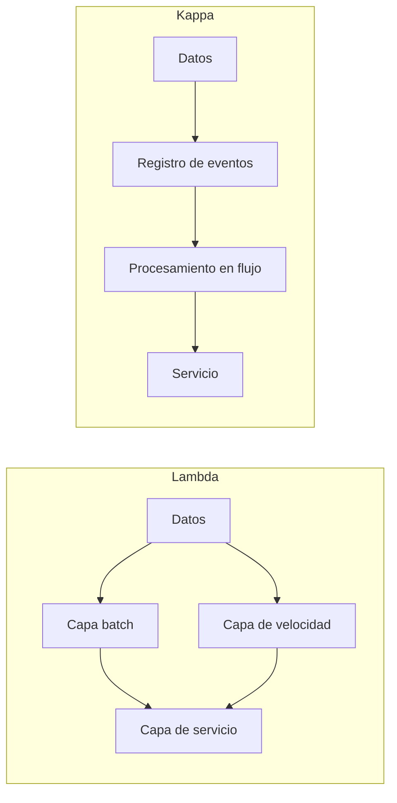

# Manual de Big Data: conceptos fundamentales

**Módulo:** MP5074 – Sistemas de Big Data · Curso 2026-27

> Este manual recoge las ideas de base que se usan en todo el módulo: qué convierte un problema en «de Big Data», cómo se organizan sus herramientas, qué arquitecturas existen, por qué la complejidad de un algoritmo obliga a repartir el trabajo y cómo se valoran el coste y la calidad de un sistema.

---

## Índice

1. [¿Qué es Big Data?](#1-qué-es-big-data)
2. [Las cinco V](#2-las-cinco-v)
3. [Tipos de datos según su estructura](#3-tipos-de-datos-según-su-estructura)
4. [Escalar: hacia arriba o hacia los lados](#4-escalar-hacia-arriba-o-hacia-los-lados)
5. [El ecosistema Big Data](#5-el-ecosistema-big-data)
6. [Procesamiento por lotes y en flujo: arquitecturas Lambda y Kappa](#6-procesamiento-por-lotes-y-en-flujo-arquitecturas-lambda-y-kappa)
7. [Perfiles profesionales](#7-perfiles-profesionales)
8. [Fundamentos: matemática discreta y lógica algorítmica](#8-fundamentos-matemática-discreta-y-lógica-algorítmica)
9. [Complejidad computacional y notación O](#9-complejidad-computacional-y-notación-o)
10. [Costes y calidad de un sistema Big Data](#10-costes-y-calidad-de-un-sistema-big-data)
11. [Planificar un proyecto de datos](#11-planificar-un-proyecto-de-datos)
12. [Conceptos clave](#12-conceptos-clave)
13. [Errores de concepto frecuentes](#13-errores-de-concepto-frecuentes)
14. [Chuleta rápida](#14-chuleta-rápida)
15. [Referencias](#15-referencias)
16. [Ejemplo resuelto: tiques duplicados](#16-ejemplo-resuelto-tiques-duplicados)

---

## 1. ¿Qué es Big Data?

Durante décadas, los datos de una empresa cabían en una base de datos relacional en un único servidor. Hoy, un móvil genera datos de ubicación cada pocos segundos, una tienda online registra cada clic y un aerogenerador manda lecturas de sus sensores varias veces por segundo. Esta es la **revolución digital**: casi toda actividad deja un rastro de datos.

El problema no es solo que haya *muchos* datos. El problema es que las herramientas clásicas dejan de servir: un solo ordenador no puede guardarlos, no puede procesarlos a tiempo o no sabe interpretar su formato. **Big Data** es el conjunto de técnicas y tecnologías que aparecen para resolver ese problema, y también la nueva forma de trabajar que traen consigo: tomar decisiones a partir de los datos y no de la intuición.

**Definición de trabajo**

> Un problema es de Big Data cuando el **volumen**, la **velocidad** o la **variedad** de los datos superan la capacidad de las herramientas tradicionales para almacenarlos, procesarlos y analizarlos en un tiempo razonable.

---

## 2. Las cinco V

Las «V» son la forma clásica de describir qué hace difíciles a estos datos:

| V | Pregunta que responde | Ejemplo |
|---|---|---|
| **Volumen** | ¿Cuántos datos hay? | Un operador de telefonía guarda petabytes de registros de llamadas. |
| **Velocidad** | ¿A qué ritmo llegan y con qué rapidez hay que responder? | Detectar un pago fraudulento con tarjeta en menos de un segundo. |
| **Variedad** | ¿Qué forma tienen? | Tablas, JSON de una API, textos de redes sociales, imágenes, audio. |
| **Veracidad** | ¿Podemos fiarnos de ellos? | Sensores que fallan, encuestas con respuestas falsas, duplicados. |
| **Valor** | ¿Qué ganamos al analizarlos? | Reducir el stock parado de un almacén un 15 %. |

- Las tres primeras describen la **dificultad técnica**.
- Las dos últimas recuerdan que almacenar datos no sirve de nada si no son fiables y no aportan algo.

Algunos autores añaden más V (variabilidad, visualización…), pero estas cinco son las que se usan en este módulo.

---

## 3. Tipos de datos según su estructura

| Tipo | Descripción | Ejemplos |
|---|---|---|
| **Estructurados** | Filas y columnas con un esquema fijo | Tabla SQL, CSV |
| **Semiestructurados** | Tienen etiquetas o claves, pero no un esquema rígido | JSON, XML |
| **No estructurados** | Sin organización interna predefinida | Texto libre, imágenes, audio, vídeo |

Los datos no estructurados son la mayor parte de los que se generan hoy. Lo veremos en detalle más adelante.

---

## 4. Escalar: hacia arriba o hacia los lados

Cuando un servidor se queda corto hay dos salidas:

| Estrategia | En qué consiste | Ventajas | Inconvenientes |
|---|---|---|---|
| **Escalado vertical** (*scale up*) | Comprar una máquina más potente | Sencillo, no cambia el software | Techo físico; el precio sube mucho más deprisa que la potencia |
| **Escalado horizontal** (*scale out*) | Repartir datos y trabajo entre muchas máquinas normales (un **clúster**) | Sin techo claro; tolera fallos de máquinas sueltas | Hay que repartir, coordinar y recuperarse de fallos |

En un clúster de mil nodos alguna máquina se rompe cada día, así que el software tiene que contar con ello.

Big Data apuesta por el escalado horizontal. La idea clave, popularizada por Hadoop, es:

> **Llevar el cálculo a donde están los datos**, en lugar de mover los datos hasta el cálculo, porque mover terabytes por la red es lo más lento de todo.

---

## 5. El ecosistema Big Data

Las herramientas se entienden mejor si se agrupan por la función que cumplen dentro del recorrido de los datos:

| Fase | Qué hace | Herramientas típicas |
|---|---|---|
| **Ingesta** | Traer los datos desde su origen | APIs, *scraping*, Flume, Sqoop, Kafka, NiFi |
| **Almacenamiento** | Guardarlos de forma escalable | HDFS, almacenamiento de objetos (S3), MongoDB, Cassandra |
| **Procesamiento** | Limpiar, transformar, agregar | MapReduce, Spark, Flink, pandas (en pequeño) |
| **Análisis** | Extraer conocimiento | SQL, Python, aprendizaje automático |
| **Visualización** | Comunicar los resultados | Matplotlib, Power BI, Grafana, cuadros de mando |

Este módulo recorre ese mismo camino: primero obtener los datos (ingesta), después almacenarlos y analizarlos, integrarlos y, por último, visualizarlos.

---

## 6. Procesamiento por lotes y en flujo: arquitecturas Lambda y Kappa

### 6.1 Dos formas de procesar

| Modo | Cómo funciona | Ventajas | Inconvenientes |
|---|---|---|---|
| **Por lotes** (*batch*) | Se acumulan los datos y se procesan todos juntos de vez en cuando (p. ej., cada noche) | Preciso y completo | Lento: el resultado llega tarde |
| **En flujo** (*streaming*) | Cada dato se procesa en cuanto llega | Rápido | Más complejo y a veces menos preciso |

### 6.2 Arquitectura Lambda

Combina los dos modos en tres capas:

1. **Capa batch:** guarda todos los datos en bruto y recalcula periódicamente vistas completas y exactas.
2. **Capa de velocidad:** procesa en tiempo real solo lo que ha llegado desde el último lote.
3. **Capa de servicio:** une los dos resultados para responder a las consultas.

**Inconveniente:** hay que escribir y mantener la misma lógica dos veces (una para el lote y otra para el flujo).

### 6.3 Arquitectura Kappa

Simplifica: lo trata todo como un flujo. Los datos se guardan en un registro de eventos (como Kafka) y, si hay que recalcular algo, se vuelve a reproducir el flujo desde el principio.

- **Ventaja:** una sola lógica que mantener.
- **Inconveniente:** depende mucho del sistema de mensajería.

### 6.4 Comparación visual



---

## 7. Perfiles profesionales

| Perfil | Qué hace |
|---|---|
| **Ingeniero/a de datos** | Construye y mantiene las tuberías (*pipelines*) que traen, limpian y guardan los datos |
| **Analista de datos** | Consulta los datos y prepara informes y cuadros de mando para el negocio |
| **Científico/a de datos** | Construye modelos estadísticos y de aprendizaje automático |
| **Administrador/a de sistemas Big Data** | Despliega y vigila los clústeres |
| **Responsable de gobierno del dato** | Vela por la calidad, la seguridad y el cumplimiento de la normativa |

En la práctica estos perfiles trabajan juntos y se solapan: por eso el currículo habla de **entornos multidisciplinares**.

---

## 8. Fundamentos: matemática discreta y lógica algorítmica

Para razonar sobre datos hace falta un poco de matemática discreta (la que trabaja con valores contables):

| Área | Para qué sirve en datos | Ejemplo |
|---|---|---|
| **Conjuntos** | Unión, intersección y diferencia al combinar tablas | `merge` en pandas, `JOIN` en SQL |
| **Lógica booleana** | `AND`, `OR` y `NOT` son la base de cualquier filtro | `df[(df.precio > 100) & (df.region == "Galicia")]` |
| **Combinatoria** | Contar combinaciones posibles | Comparar todos los clientes con todos: n·(n−1)/2 parejas |
| **Grafos** | Modelar relaciones con nodos y aristas | Redes sociales, rutas, dependencias entre tareas |

Un **algoritmo** es una secuencia finita y ordenada de pasos para resolver un problema. Lo que nos interesa en Big Data no es solo que funcione, sino **cuánto tarda cuando los datos crecen**.

---

## 9. Complejidad computacional y notación O

La **notación O grande** describe cómo crece el número de operaciones de un algoritmo en función del tamaño de la entrada *n*, ignorando constantes. No mide segundos, mide **tendencia**.

| Complejidad | Nombre | Ejemplo |
|---|---|---|
| O(1) | Constante | Acceder a un elemento de un diccionario por su clave |
| O(log n) | Logarítmica | Búsqueda binaria en una lista ordenada |
| O(n) | Lineal | Recorrer un fichero una vez para sumar una columna |
| O(n log n) | Casi lineal | Ordenar (los buenos algoritmos de ordenación) |
| O(n²) | Cuadrática | Comparar cada registro con todos los demás |
| O(2ⁿ) | Exponencial | Probar todos los subconjuntos posibles |

Con pocos datos, todas parecen rápidas. Con miles de millones, solo las lineales o casi lineales son viables, y aun así puede que un solo ordenador no baste.

> Por eso en Big Data se buscan algoritmos que se puedan **dividir**: si un trabajo O(n) se reparte entre *k* máquinas, cada una hace n/k.

---

## 10. Costes y calidad de un sistema Big Data

### 10.1 Costes

| Tipo de coste | Incluye |
|---|---|
| **Infraestructura** | Servidores propios (*on-premise*) o en la nube (pago por uso), almacenamiento, red |
| **Personal** | Perfiles especializados y formación |
| **Software y licencias** | Muchas herramientas son libres, pero el soporte empresarial no |
| **Operación** | Energía, mantenimiento, seguridad, copias |

### 10.2 Criterios de calidad

| Criterio | Pregunta |
|---|---|
| **Disponibilidad** | ¿Está siempre funcionando? |
| **Escalabilidad** | ¿Aguanta el doble de datos? |
| **Rendimiento** | ¿Responde a tiempo? |
| **Tolerancia a fallos** | ¿Sigue funcionando si cae una máquina? |
| **Seguridad** | ¿Están protegidos los datos y los accesos? |
| **Calidad del dato** | ¿Son los datos exactos, completos, actuales y coherentes? |

> **Regla práctica:** no todo problema con muchos datos necesita un clúster. Si los datos caben en la memoria de un portátil, pandas suele ser más barato y rápido que Spark.

---

## 11. Planificar un proyecto de datos

Un proyecto de datos sigue unas fases parecidas a las de cualquier proyecto, y conviene fijar objetivos y prioridades desde el principio:

1. **Definir la pregunta de negocio** (qué queremos saber y para qué).
2. **Identificar las fuentes** y comprobar que se pueden usar legalmente.
3. **Obtener y almacenar** los datos.
4. **Limpiar y transformar.** Suele llevarse más de la mitad del tiempo.
5. **Analizar y modelar.**
6. **Comunicar** los resultados (visualización, informe).
7. **Desplegar y mantener.**

Para organizar el tiempo:

- Trocea el trabajo en **tareas pequeñas**.
- **Priorízalas**: lo imprescindible antes que lo deseable.
- **Revisa el avance** a menudo.

Es lo que haremos en el proyecto integrador.

---

## 12. Conceptos clave

| Concepto | Explicación breve |
|---|---|
| Big Data | Datos cuyo volumen, velocidad o variedad superan las herramientas tradicionales. |
| Las cinco V | Volumen, velocidad, variedad, veracidad y valor. |
| Escalado horizontal | Añadir más máquinas al clúster en lugar de una máquina más grande. |
| Clúster | Conjunto de ordenadores que trabajan coordinados como si fueran uno. |
| Procesamiento por lotes | Procesar datos acumulados de una vez, cada cierto tiempo. |
| Procesamiento en flujo | Procesar cada dato en el momento en que llega. |
| Arquitectura Lambda | Combina una capa batch y una capa de velocidad que se unen en una capa de servicio. |
| Arquitectura Kappa | Lo procesa todo como flujo y recalcula reproduciendo el registro de eventos. |
| Notación O | Forma de expresar cómo crece el coste de un algoritmo con el tamaño de los datos. |
| Calidad del dato | Grado en que los datos son exactos, completos, actuales y coherentes. |

---

## 13. Errores de concepto frecuentes

| Idea equivocada | Por qué no es así |
|---|---|
| «Big Data = muchos datos» | El volumen es solo una V: también cuentan la velocidad y la variedad, y sin veracidad ni valor no sirve de nada. |
| «Con más datos siempre necesito Spark» | Si caben en la memoria de una máquina, pandas suele ser más rápido y barato. |
| «Un servidor más potente lo resuelve todo» | El escalado vertical tiene techo y su precio crece mucho más deprisa que la potencia. |
| «La notación O mide el tiempo en segundos» | Mide cómo **crece** el coste con *n*; las constantes y el hardware se ignoran. |
| «Lambda y Kappa son herramientas» | Son **arquitecturas** (formas de organizar el sistema), que se implementan con herramientas como Spark o Kafka. |
| «Lo difícil es analizar» | La limpieza y transformación suelen llevarse más de la mitad del tiempo del proyecto. |

---

## 14. Chuleta rápida

```text
# ---------- Las cinco V ----------
Volumen · Velocidad · Variedad      → dificultad técnica
Veracidad · Valor                    → ¿fiables? ¿útiles?

# ---------- Escalado ----------
Vertical  (scale up)   → máquina más grande  (techo físico)
Horizontal (scale out) → más máquinas         (clúster)
Principio: llevar el cálculo a los datos

# ---------- Recorrido del dato ----------
Ingesta → Almacenamiento → Procesamiento → Análisis → Visualización

# ---------- Arquitecturas ----------
Lambda → batch + velocidad + servicio  (lógica duplicada)
Kappa  → todo es flujo + registro de eventos (una sola lógica)

# ---------- Complejidad (de mejor a peor) ----------
O(1) < O(log n) < O(n) < O(n log n) < O(n²) < O(2ⁿ)
Repartir un O(n) entre k máquinas → n/k por máquina
```

---

## 15. Referencias

- Apache Hadoop: <https://hadoop.apache.org/>
- Apache Spark: <https://spark.apache.org/>
- Apache Kafka: <https://kafka.apache.org/>
- Apache Flink: <https://flink.apache.org/>
- J. Kreps, *Questioning the Lambda Architecture* (O'Reilly Radar): <https://www.oreilly.com/radar/questioning-the-lambda-architecture/>
- Resumen de complejidades de estructuras de datos y algoritmos: <https://www.bigocheatsheet.com/>

---

## 16. Ejemplo resuelto: tiques duplicados

**Situación.** Una cadena de supermercados tiene **1 000 millones** (10⁹) de tiques de compra y quiere encontrar los tiques duplicados (el mismo tique registrado dos veces por un error de la caja). Un ordenador hace unos **10⁸ operaciones sencillas por segundo**. Se plantean dos algoritmos.

**Algoritmo A: comparar todos con todos.** Para cada tique, se compara con todos los demás.

- Número de comparaciones: n·(n−1)/2 ≈ n²/2 = (10⁹)² / 2 = 5·10¹⁷.
- Tiempo: 5·10¹⁷ / 10⁸ = 5·10⁹ segundos.
- En años: 5·10⁹ / (60·60·24·365) ≈ 5·10⁹ / 3,15·10⁷ ≈ **159 años**.

Complejidad O(n²): inviable.

**Algoritmo B: usar un diccionario (tabla hash).** Se recorre la lista una vez; para cada tique se mira si su identificador ya está en un diccionario (O(1)) y, si no, se añade.

- Operaciones: unas n = 10⁹.
- Tiempo: 10⁹ / 10⁸ = **10 segundos** de cálculo.

Complejidad O(n): el algoritmo es viable. Pero aparece otro límite: si cada entrada del diccionario ocupa unos 100 bytes, harían falta 10⁹ · 100 B = 10¹¹ B = **100 GB de memoria RAM**, más de lo que tiene un portátil (16 GB).

**Algoritmo C: repartir entre 10 máquinas.** Se reparten los tiques según el resto de dividir su identificador entre 10 (así, dos tiques iguales caen siempre en la misma máquina). Cada máquina aplica el algoritmo B a su parte:

- Datos por máquina: 10⁹ / 10 = 10⁸ tiques.
- Memoria por máquina: 10⁸ · 100 B = 10 GB, que **sí cabe**.
- Tiempo por máquina: 10⁸ / 10⁸ = 1 segundo, más el tiempo de repartir los datos por la red.

**Coste.** Supongamos que alquilar en la nube una máquina con 16 GB cuesta 0,20 € por hora y que el trabajo completo, contando la transferencia, tarda 15 minutos:

- 10 máquinas × 0,25 h × 0,20 €/h = **0,50 €** por ejecución.
- Una única máquina con 128 GB podría costar 1,50 €/h; con 0,25 h saldrían **0,375 €**, más barato en este caso, pero con techo: si mañana hay 10 veces más tiques, no existe una máquina 10 veces mayor a un precio razonable, mientras que el clúster solo necesita 100 máquinas.

**Conclusión.** El ejemplo junta las ideas del manual: la **complejidad** descarta el algoritmo A; el **volumen** hace que el algoritmo B no quepa en una máquina; el **escalado horizontal** lo resuelve repartiendo los datos; y el **análisis de costes** muestra que la decisión depende del tamaño actual y del crecimiento esperado.
