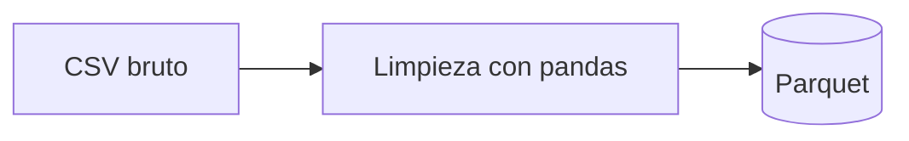
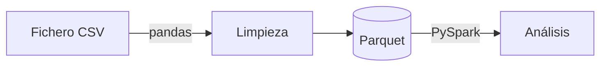

# Manual de Markdown

**Módulo:** MP5074 – Sistemas de Big Data · Curso 2026-27

> Markdown es un lenguaje de marcado ligero: texto plano con unos pocos símbolos (`#`, `*`, `-`, `` ` ``…) que se convierte en un documento con formato. En este módulo lo usaremos para **documentar los notebooks** (celdas Markdown de Jupyter), escribir el **`README.md`** de cada proyecto en GitHub y redactar **esta misma web** de materiales. Ver también los manuales de [JupyterLab](../jupyterlab/manual_jupyterlab.md) (sección 9) y [Git](../git/manual_git.md).

---

## Índice

1. [¿Qué es Markdown y dónde lo usamos?](#1-qué-es-markdown-y-dónde-lo-usamos)
2. [Párrafos y saltos de línea](#2-párrafos-y-saltos-de-línea)
3. [Títulos](#3-títulos)
4. [Énfasis: negrita, cursiva y tachado](#4-énfasis-negrita-cursiva-y-tachado)
5. [Listas](#5-listas)
6. [Enlaces](#6-enlaces)
7. [Imágenes](#7-imágenes)
8. [Código](#8-código)
9. [Tablas](#9-tablas)
10. [Citas, separadores y notas al pie](#10-citas-separadores-y-notas-al-pie)
11. [Caracteres especiales y HTML](#11-caracteres-especiales-y-html)
12. [Fórmulas matemáticas](#12-fórmulas-matemáticas)
13. [Markdown en Jupyter](#13-markdown-en-jupyter)
14. [Markdown en GitHub](#14-markdown-en-github)
15. [El `README.md` de un proyecto de datos](#15-el-readmemd-de-un-proyecto-de-datos)
16. [Markdown en la web del módulo (Zensical)](#16-markdown-en-la-web-del-módulo-zensical)
17. [Herramientas](#17-herramientas)
18. [Buenas prácticas](#18-buenas-prácticas)
19. [Solución de problemas frecuentes](#19-solución-de-problemas-frecuentes)
20. [Chuleta rápida](#20-chuleta-rápida)
21. [Referencias](#21-referencias)

---

## 1. ¿Qué es Markdown y dónde lo usamos?

Markdown fue creado en 2004 por John Gruber con una idea: que el texto **se pueda leer tal cual**, sin procesar, y que a la vez se pueda convertir en HTML. Los archivos tienen extensión **`.md`**.

```markdown
## Resultados

Las ventas **crecieron un 12 %** respecto a 2025.
```

se convierte en:

> **Resultados** (como título)
>
> Las ventas **crecieron un 12 %** respecto a 2025.

**Dónde lo usaremos:**

| Dónde | Para qué |
|---|---|
| Celdas Markdown de **Jupyter** | Explicar el análisis: objetivos, pasos, conclusiones |
| **`README.md`** en GitHub | Presentar un proyecto: qué hace, cómo instalarlo, cómo ejecutarlo |
| *Pull requests*, *issues* y comentarios de GitHub | Describir cambios y discutirlos |
| Esta **web del módulo** | Todos los manuales están escritos en Markdown y Zensical los convierte en web |
| Documentación técnica en general | Wikis, MkDocs, Docusaurus, Obsidian, Notion… |

### Variantes (*sabores*)

El Markdown original dejaba cosas sin definir, así que cada herramienta añadió extensiones:

| Variante | Dónde | Extras sobre lo básico |
|---|---|---|
| **CommonMark** | Estándar de referencia | La base común, bien especificada |
| **GFM** (*GitHub Flavored Markdown*) | GitHub, VS Code, JupyterLab | Tablas, listas de tareas, tachado, enlaces automáticos |
| **Jupyter** | Notebooks | GFM + fórmulas LaTeX + imágenes adjuntas |
| **Python-Markdown + extensiones** | Zensical / MkDocs (esta web) | Avisos, pestañas, diagramas, teclas… (sección 16) |

> Lo de las secciones 2 a 11 funciona **en todas partes**. Lo específico de cada herramienta está en las secciones 12 a 16.

---

## 2. Párrafos y saltos de línea

- Un **párrafo** es un bloque de líneas seguidas. Los párrafos se separan con **una línea en blanco**.
- Un **salto de línea simple** dentro de un párrafo **se ignora**: las líneas se unen.

```markdown
Esta es la primera línea
y esta se une a la anterior en el mismo párrafo.

Este es otro párrafo.
```

Para forzar un salto de línea sin empezar párrafo nuevo, termina la línea con **una barra invertida** `\` (o con dos espacios, que no se ven y es fácil perderlos):

```markdown
IES Fernando Wirtz Suárez\
Ferrol
```

> **Regla de oro:** deja una línea en blanco **antes y después** de títulos, listas, tablas, bloques de código y citas. La mayoría de los problemas de formato se deben a que falta esa línea.

---

## 3. Títulos

```markdown
# Título de nivel 1
## Título de nivel 2
### Título de nivel 3
#### Título de nivel 4
```

- Deja **un espacio** después de las almohadillas: `## Título`, no `##Título`.
- Usa **un solo `#`** por documento (el título principal) y no te saltes niveles (de `##` a `####`).
- Los títulos generan el **índice** automático en Jupyter, GitHub y esta web, y crean **anclas** para enlazarlos (sección 6.3).

---

## 4. Énfasis: negrita, cursiva y tachado

| Escribes | Resultado |
|---|---|
| `**negrita**` | **negrita** |
| `*cursiva*` o `_cursiva_` | *cursiva* |
| `***negrita y cursiva***` | ***negrita y cursiva*** |
| `~~tachado~~` | ~~tachado~~ (GFM) |
| `` `código` `` | `código` |

> Usa la negrita con moderación: si todo está en negrita, nada destaca. Para nombres de ficheros, columnas, funciones y comandos usa `código`, no negrita.

---

## 5. Listas

### 5.1 Sin orden y numeradas

```markdown
- Leer el CSV
- Limpiar los nulos
- Guardar en Parquet

1. Instalar WSL
2. Instalar Miniconda
3. Crear el entorno `bigdata`
```

- Para listas sin orden se puede usar `-`, `*` o `+`; elige uno y úsalo siempre (`-` es lo más habitual).
- En las numeradas, el número real **lo pone el conversor**: puedes escribir `1.` en todas las líneas y saldrán 1, 2, 3.

### 5.2 Listas anidadas y contenido dentro de un elemento

El contenido de un elemento se **sangra con 4 espacios**:

````markdown
1. Crear el entorno:

    ```bash
    conda create -n bigdata python=3.12
    ```

2. Activarlo y comprobar la versión:
    - `conda activate bigdata`
    - `python --version`
````

> GitHub y Jupyter aceptan sangrías de 2 o 3 espacios, pero **esta web (Python-Markdown) necesita 4**. Usa siempre 4 y funcionará en todas partes.

### 5.3 Listas de tareas

```markdown
- [x] Descargar los datos
- [x] Limpiar duplicados
- [ ] Analizar por provincia
```

- [x] Descargar los datos
- [x] Limpiar duplicados
- [ ] Analizar por provincia

---

## 6. Enlaces

### 6.1 Enlaces externos

```markdown
[Documentación de pandas](https://pandas.pydata.org/docs/)
[pandas](https://pandas.pydata.org "Texto que aparece al pasar el ratón")
<https://spark.apache.org>
```

### 6.2 Enlaces a otros ficheros del proyecto (rutas relativas)

```markdown
[Notebook de limpieza](notebooks/01_limpieza.ipynb)
[Manual de Git](../git/manual_git.md)
[Datos de muestra](datos/muestra/ventas.csv)
```

Las rutas son **relativas al fichero que contiene el enlace** (repasa [Conocimientos previos](../../conocimientos_previos/manual_conocimientos_previos.md), sección 4). Así siguen funcionando aunque el proyecto se mueva o se clone en otro equipo.

### 6.3 Enlaces a un apartado (anclas)

Cada título crea un **ancla**. Se enlaza con `#` seguido del título transformado:

```markdown
[Ir a la instalación](#3-instalación)
[Agrupar en el manual de pandas](../pandas/manual_pandas.md#12-agrupar-y-agregar)
```

Cómo se forma el ancla (GitHub y esta web): **minúsculas**, los espacios pasan a **guiones**, se **quitan** los signos de puntuación (`.`, `:`, `¿`, `?`, `` ` ``, paréntesis…) y se **conservan las tildes**:

| Título | Ancla |
|---|---|
| `## 3. Instalación` | `#3-instalación` |
| `## 12. Agrupar y agregar` | `#12-agrupar-y-agregar` |
| `## ¿Qué es Spark?` | `#qué-es-spark` |
| `## El fichero `config`` | `#el-fichero-config` |

> En **Jupyter** el ancla conserva las **mayúsculas** y los signos: `## 3. Instalación` → `#3.-Instalación`. Ver sección 13.3.

### 6.4 Enlaces por referencia

Útiles cuando una URL larga se repite o para que el texto se lea mejor:

```markdown
Usaremos [Spark][spark] y [pandas][pd].

[spark]: https://spark.apache.org
[pd]: https://pandas.pydata.org
```

---

## 7. Imágenes

Igual que un enlace, con `!` delante. El texto entre corchetes es el **texto alternativo** (lo que se lee si la imagen no carga y lo que usan los lectores de pantalla):

```markdown


```

- Guarda las imágenes **dentro del proyecto** (por ejemplo, en `imagenes/` o `assets/`) y enlázalas con ruta relativa.
- Markdown no permite fijar el tamaño. Si lo necesitas, usa HTML (sección 11.2) o, en esta web, atributos (sección 16.8).
- Una imagen que es también un enlace: `[](https://destino)`.

---

## 8. Código

### 8.1 En línea

```markdown
Usa `df.groupby("tienda")` para agrupar y `git status` antes de cada commit.
```

Si el código contiene comillas invertidas, rodéalo con **dos**: ``` `` `ls -l` `` ```.

### 8.2 Bloques de código

Se rodean con **tres comillas invertidas** e indicando el **lenguaje** para el resaltado de sintaxis:

````markdown
```python
import pandas as pd
df = pd.read_csv("datos/ventas.csv")
```
````

Lenguajes que más usaremos:

| Etiqueta | Para |
|---|---|
| `python` | Python, pandas, PySpark |
| `bash` | Comandos de Linux / WSL |
| `powershell` | Comandos de Windows |
| `sql` | Consultas SQL, Hive, Spark SQL |
| `yaml` | `environment.yml`, `compose.yaml` |
| `json` | Ficheros y respuestas JSON |
| `text` | Salidas de programas, sin resaltado |
| `markdown` | Ejemplos de Markdown |
| `dockerfile`, `toml`, `ini`, `xml`, `csv` | Otros formatos |

Para mostrar un bloque de código **que contiene** un bloque de código (como los ejemplos de este manual), usa **cuatro** comillas invertidas fuera y tres dentro.

> Muestra las **salidas** de los programas en un bloque `text` separado del código: así se distingue lo que se escribe de lo que se obtiene.

---

## 9. Tablas

```markdown
| Tienda | Ventas | Variación |
|:-------|-------:|:---------:|
| Ferrol | 1.250  |   +5 %    |
| Vigo   | 980    |   −2 %    |
```

| Tienda | Ventas | Variación |
|:-------|-------:|:---------:|
| Ferrol | 1.250  |   +5 %    |
| Vigo   | 980    |   −2 %    |

- La segunda línea separa la cabecera del cuerpo. Los `:` indican la **alineación**: `:---` izquierda, `---:` derecha (para números), `:---:` centrada.
- **No hace falta alinear** las barras en el texto; solo ayuda a leerlo.
- Dentro de una celda puedes usar negrita, cursiva, `código` y enlaces, pero **no** saltos de línea ni listas (usa `<br>` si lo necesitas).
- Para escribir una barra `|` dentro de una celda: `\|`.

> Desde pandas puedes generar una tabla Markdown a partir de un DataFrame: `print(df.head().to_markdown(index=False))` (requiere el paquete `tabulate`).

---

## 10. Citas, separadores y notas al pie

### 10.1 Citas

```markdown
> Las fuentes de datos deben citarse siempre.
>
> Una cita puede tener varios párrafos y **formato**.
```

En los manuales del módulo las citas se usan para **notas y avisos** destacados.

### 10.2 Separadores

Una línea con **tres guiones** (con una línea en blanco antes) dibuja una línea horizontal:

```markdown
Fin de la sección.

---

## Siguiente sección
```

### 10.3 Notas al pie

```markdown
Los datos proceden del INE[^1].

[^1]: Instituto Nacional de Estadística, <https://www.ine.es>.
```

La nota se muestra al final del documento con un enlace de ida y vuelta. Funciona en GitHub, en Jupyter (según la versión) y en esta web.

---

## 11. Caracteres especiales y HTML

### 11.1 Escapar caracteres

Para que un símbolo de Markdown aparezca tal cual, se antepone `\`:

```markdown
\*no es cursiva\*
2 \* 3 = 6
\# no es un título
precio\_unitario
```

Caracteres que pueden necesitarlo: `` \ ` * _ { } [ ] ( ) # + - . ! | < > ``. Dentro de `código` **no** hace falta escapar nada.

### 11.2 HTML dentro de Markdown

Casi todas las herramientas aceptan HTML para lo que Markdown no cubre:

```markdown


Texto con <sub>subíndice</sub>, <sup>superíndice</sup> y <kbd>Ctrl</kbd> + <kbd>C</kbd>.

<!-- Esto es un comentario: no se muestra -->

<details>
<summary>Ver la solución</summary>

La solución es `df.dropna()`.

</details>
```

> Deja una línea en blanco entre las etiquetas HTML y el Markdown que contienen; si no, el Markdown de dentro no se interpreta. GitHub elimina por seguridad el HTML "peligroso" (`<script>`, `style`…).

---

## 12. Fórmulas matemáticas

Jupyter, GitHub y VS Code entienden fórmulas en notación **LaTeX** (las dibuja MathJax o KaTeX):

```markdown
La media muestral es $\bar{x} = \frac{1}{n}\sum_{i=1}^{n} x_i$.

$$
\sigma = \sqrt{\frac{1}{n}\sum_{i=1}^{n}(x_i - \bar{x})^2}
$$
```

- `$...$` → fórmula **en línea**, dentro del texto.
- `$$...$$` → fórmula **en bloque**, centrada en su propia línea.

| Escribes | Significado |
|---|---|
| `x^2`, `x_i`, `x_{ij}` | Superíndice, subíndice |
| `\frac{a}{b}` | Fracción |
| `\sqrt{x}` | Raíz |
| `\sum_{i=1}^{n}`, `\prod`, `\int` | Sumatorio, productorio, integral |
| `\bar{x}`, `\hat{y}` | Media, estimación |
| `\alpha`, `\beta`, `\mu`, `\sigma`, `\lambda` | Letras griegas |
| `\leq`, `\geq`, `\neq`, `\approx` | ≤, ≥, ≠, ≈ |
| `\cdot`, `\times` | Producto |
| `\text{texto}` | Texto normal dentro de la fórmula |

> Esta web no tiene activadas las fórmulas: en los manuales se escriben con caracteres normales (σ, x̄, ≤) o en bloques de código.

---

## 13. Markdown en Jupyter

### 13.1 Celdas Markdown

| Acción | Cómo |
|---|---|
| Convertir una celda en Markdown | Modo comando (`Esc`) y `M` |
| Volver a código | `Esc` y `Y` |
| Ver el resultado (renderizar) | `Shift + Intro` |
| Volver a editar | Doble clic sobre la celda o `Intro` |

### 13.2 Estructura recomendada de un notebook

```markdown
# Análisis de ventas 2026

**Autor:** Ana García · **Fecha:** 20/10/2026 · **Datos:** `datos/ventas_2026.csv`

## Objetivo
Identificar qué tiendas y categorías concentran la facturación.

## 1. Carga de datos
...

## 2. Limpieza
...

## 3. Análisis

## 4. Conclusiones
- Ferrol concentra el 30 % de la facturación.
- ...
```

Pon una celda Markdown **antes de cada bloque de código** explicando qué se va a hacer y, después de los resultados importantes, otra con **qué significan**. Los títulos aparecen en el panel **Table of Contents** de JupyterLab.

### 13.3 Enlazar apartados del notebook

En Jupyter, el ancla es el título con los espacios cambiados por guiones, **conservando mayúsculas y signos**:

```markdown
[Ir a la limpieza](#2.-Limpieza)
[Ver conclusiones](#4.-Conclusiones)
```

> Si dudas, pasa el ratón por el título renderizado: aparece un símbolo `¶` que es el enlace al ancla; haz clic y mira la URL.

### 13.4 Imágenes en el notebook

- **Desde un fichero** del proyecto: `` (ruta relativa al notebook).
- **Pegando o arrastrando** una imagen sobre una celda Markdown en edición: Jupyter la guarda **dentro del notebook** como adjunto: ``. Es cómodo, pero aumenta el tamaño del `.ipynb`.

### 13.5 Generar Markdown desde código

```python
from IPython.display import Markdown, display

total = 125_430.5
display(Markdown(f"### Facturación total: **{total:,.2f} €**"))
display(Markdown(df.head().to_markdown(index=False)))   # tabla (requiere tabulate)
```

---

## 14. Markdown en GitHub

GitHub interpreta Markdown en ficheros `.md`, en la descripción de *pull requests* e *issues* y en los comentarios. Además de lo anterior, ofrece:

### 14.1 Avisos (*alerts*)

```markdown
> [!NOTE]
> Información útil que conviene conocer.

> [!TIP]
> Un consejo para hacerlo mejor o más rápido.

> [!IMPORTANT]
> Información clave para conseguir el objetivo.

> [!WARNING]
> Requiere atención inmediata para evitar problemas.

> [!CAUTION]
> Riesgo o consecuencias negativas de una acción.
```

### 14.2 Referencias automáticas

| Escribes | GitHub lo convierte en |
|---|---|
| `#12` | Enlace a la *issue* o *pull request* número 12 |
| `@usuario` | Mención (le llega una notificación) |
| `a1b2c3d` (hash de un commit) | Enlace a ese commit |
| `Closes #12` en un PR | Cierra la *issue* 12 al fusionar el PR |
| `:rocket:`, `:white_check_mark:` | Emoji 🚀 ✅ |

### 14.3 Diagramas Mermaid

GitHub dibuja diagramas escritos en texto con [Mermaid](https://mermaid.js.org/) (esta web también, sección 16.7):

````markdown

````

### 14.4 Plantillas

- **`README.md`** en la raíz: se muestra en la portada del repositorio (sección 15).
- **`.github/pull_request_template.md`**: texto inicial de cada PR (ver [manual de Git](../git/manual_git.md), sección 13.2).
- **`.github/ISSUE_TEMPLATE/`**: plantillas para *issues*.

---

## 15. El `README.md` de un proyecto de datos

Es lo primero que ve quien abre el repositorio. Debe responder: **qué es, cómo lo instalo, de dónde salen los datos, cómo lo ejecuto y qué se obtiene**.

````markdown
# Análisis de calidad del aire en Galicia

Limpieza y análisis de las lecturas de NO₂ y PM10 de las estaciones de la
red de calidad del aire de Galicia (2026).

## Estructura

```text
calidad-aire/
├── datos/            # No se sube a Git (ver "Datos")
├── notebooks/
│   ├── 01_limpieza.ipynb
│   └── 02_analisis.ipynb
├── src/              # Funciones reutilizables
├── environment.yml
└── README.md
```

## Instalación

```bash
conda env create -f environment.yml
conda activate calidad-aire
```

## Datos

Descarga el CSV del portal de datos abiertos de la Xunta
(<https://abertos.xunta.gal>) y guárdalo en `datos/brutos/`.
Licencia: CC BY 4.0.

## Uso

1. Ejecuta `notebooks/01_limpieza.ipynb` → genera `datos/procesados/aire.parquet`.
2. Ejecuta `notebooks/02_analisis.ipynb` → gráficos y conclusiones.

## Resultados

- La estación de Vigo supera el límite de NO₂ en 12 días de enero.

## Autoría

Ana García y Brais López · MP5074 Sistemas de Big Data · IES Fernando Wirtz Suárez
````

> Escribe el README **al empezar** el proyecto y actualízalo con cada cambio importante. Un proyecto sin README es un proyecto que nadie (ni tú dentro de tres meses) sabe ejecutar.

---

## 16. Markdown en la web del módulo (Zensical)

Esta web se genera con **Zensical** a partir de los ficheros `.md` de la carpeta `docs/`. Además del Markdown estándar, tiene activadas varias extensiones (ver `zensical.toml`). Cada ejemplo muestra el código y, debajo, cómo se ve.

### 16.1 Avisos (*admonitions*)

```markdown
!!! warning "Scraping responsable"
    Revisa el `robots.txt` antes de extraer datos de una web.
```

!!! warning "Scraping responsable"
    Revisa el `robots.txt` antes de extraer datos de una web.

- El contenido va **sangrado 4 espacios**.
- El título entre comillas es opcional; `!!! note ""` crea un aviso sin título.
- Tipos: `note`, `abstract`, `info`, `tip`, `success`, `question`, `warning`, `failure`, `danger`, `bug`, `example`, `quote`.

### 16.2 Bloques plegables

```markdown
??? tip "Pista"
    Usa `groupby` y después `agg`.

???+ example "Solución (abierta por defecto)"
    `df.groupby("tienda").agg(total=("importe", "sum"))`
```

??? tip "Pista"
    Usa `groupby` y después `agg`.

???+ example "Solución (abierta por defecto)"
    `df.groupby("tienda").agg(total=("importe", "sum"))`

### 16.3 Pestañas

Muy útiles para mostrar lo mismo en varios sistemas (como en el [manual de SSH](../ssh/manual_ssh.md)):

````markdown
=== "Linux / WSL"

    ```bash
    ls ~/.ssh
    ```

=== "Windows (PowerShell)"

    ```powershell
    Get-ChildItem $env:USERPROFILE\.ssh
    ```
````

=== "Linux / WSL"

    ```bash
    ls ~/.ssh
    ```

=== "Windows (PowerShell)"

    ```powershell
    Get-ChildItem $env:USERPROFILE\.ssh
    ```

### 16.4 Teclas, resaltado y abreviaturas

```markdown
Pulsa ++ctrl+shift+v++ para ver la vista previa.

Lo más importante es ==guardar en Parquet==.

El RGPD regula el tratamiento de datos personales.

*[RGPD]: Reglamento General de Protección de Datos
```

Pulsa ++ctrl+shift+v++ para ver la vista previa.

Lo más importante es ==guardar en Parquet==.

El RGPD regula el tratamiento de datos personales (pasa el ratón por encima de la sigla).

*[RGPD]: Reglamento General de Protección de Datos

### 16.5 Anotaciones en el código

Un comentario `# (1)!` coloca un botón numerado en el código; la explicación va en una lista numerada **justo después** del bloque:

````markdown
```python
df = pd.read_csv("ventas.csv", sep=";", decimal=",")  # (1)!
df.groupby("tienda")["importe"].sum()  # (2)!
```

1.  CSV con formato español: `;` como separador y coma decimal.
2.  Facturación total por tienda.
````

```python
df = pd.read_csv("ventas.csv", sep=";", decimal=",")  # (1)!
df.groupby("tienda")["importe"].sum()  # (2)!
```

1.  CSV con formato español: `;` como separador y coma decimal.
2.  Facturación total por tienda.

### 16.6 Iconos y emoji

```markdown
:material-database: Base de datos · :fontawesome-brands-github: GitHub · :rocket: · :white_check_mark:
```

:material-database: Base de datos · :fontawesome-brands-github: GitHub · :rocket: · :white_check_mark:

### 16.7 Diagramas Mermaid

````markdown

````


### 16.8 Atributos y HTML con Markdown dentro

Con `{ ... }` detrás de un elemento se le añaden clases o atributos:

```markdown
{ width="400" }

[Descargar datos](datos/ventas.csv){ .md-button }

<span class="ud ud2">UD2</span> Orixes de datos
```

[Ir al inicio del manual](#manual-de-markdown){ .md-button }

Para escribir Markdown **dentro** de una etiqueta HTML, añade el atributo `markdown`:

```markdown
<div class="grid cards" markdown>

- **WSL** · Ubuntu dentro de Windows
- **Git** · Control de versiones

</div>
```

<div class="grid cards" markdown>

- **WSL** · Ubuntu dentro de Windows
- **Git** · Control de versiones

</div>

### 16.9 Añadir un manual nuevo a la web

1. Crea la carpeta y el fichero: `docs/ud1/manuales/<tema>/manual_<tema>.md`.
2. Añádelo al menú en `zensical.toml`, en la lista `nav`, en el lugar que le corresponda:

    ```toml
    { "Markdown" = "ud1/manuales/markdown/manual_markdown.md" },
    ```

3. Añádelo a la tabla de `docs/ud1/manuales/index.md` y a la portada `docs/index.md`.
4. Comprueba el resultado:

    ```bash
    zensical serve      # vista previa en http://localhost:8000 (se recarga al guardar)
    zensical build      # genera la web en site/ y avisa de enlaces y anclas rotos
    ```

---

## 17. Herramientas

### 17.1 VS Code

| Acción | Cómo |
|---|---|
| Vista previa en otra pestaña | `Ctrl + Shift + V` |
| Vista previa al lado | `Ctrl + K` y después `V` |
| Índice del documento | Panel **Outline** (Explorador) |
| Formatear tablas y listas | Extensión *Markdown All in One* |
| Revisar el estilo | Extensión *markdownlint* |
| Pegar una imagen | Arrastrar al editor con `Shift` pulsado: la copia al proyecto y escribe el enlace |

### 17.2 Convertir Markdown a otros formatos con Pandoc

[Pandoc](https://pandoc.org/) convierte Markdown en Word, PDF, HTML, presentaciones…

```bash
sudo apt install -y pandoc
pandoc README.md -o README.docx
pandoc README.md -o README.html --standalone
pandoc informe.md -o informe.pdf          # requiere una instalación de LaTeX
```

Un notebook también se puede exportar a Markdown: `jupyter nbconvert --to markdown analisis.ipynb` (ver [manual de JupyterLab](../jupyterlab/manual_jupyterlab.md), sección 13).

---

## 18. Buenas prácticas

1. **Una línea en blanco** antes y después de títulos, listas, tablas, bloques de código y citas.
2. **Un solo `#`** por documento y títulos en orden (`##` → `###`), sin saltar niveles.
3. Indica siempre el **lenguaje** en los bloques de código.
4. Usa **rutas relativas** en enlaces e imágenes.
5. Escribe **texto alternativo** descriptivo en las imágenes.
6. `código` para nombres de ficheros, columnas, funciones y comandos; **negrita** solo para lo realmente importante.
7. **Sangría de 4 espacios** para contenido anidado (listas, avisos, pestañas).
8. Frases y párrafos **cortos**; listas y tablas cuando haya varios elementos comparables.
9. En los notebooks, **explica el porqué**, no solo el qué: el código ya dice qué hace.
10. Revisa siempre la **vista previa** antes de entregar o de hacer commit.

---

## 19. Solución de problemas frecuentes

| Problema | Causa probable | Solución |
|---|---|---|
| El título aparece como texto `##Título` | Falta el espacio tras `#` | `## Título` |
| Dos líneas aparecen unidas en una | Un salto simple no separa párrafos | Línea en blanco entre ellas, o `\` al final de la primera |
| La lista o la tabla no se forma | Falta la línea en blanco antes | Añade una línea en blanco antes de la lista o tabla |
| La lista anidada sale plana (en esta web) | Sangría de 2 espacios | Sangra 4 espacios |
| El bloque de código "se come" el resto del documento | Falta cerrar las ```` ``` ```` | Cierra el bloque con la misma cantidad de comillas invertidas |
| Aparecen cursivas donde no debían (`precio_unitario_iva`) | `*` o `_` interpretados como énfasis | Pon el nombre como `código` o escapa con `\_` |
| La tabla sale como texto | Falta la línea separadora `|---|---|` o el nº de columnas no cuadra | Revisa la segunda línea y que todas las filas tengan las mismas columnas |
| La imagen no se ve | Ruta incorrecta o mayúsculas distintas (Linux las distingue) | Ruta relativa al fichero `.md`; comprueba el nombre exacto |
| El enlace a un apartado no funciona | Ancla mal escrita | Revisa la sección 6.3 (o 13.3 en Jupyter); en esta web, `zensical build` avisa |
| Las fórmulas `$...$` no se dibujan | La herramienta no tiene activado MathJax/KaTeX | Usa Jupyter o GitHub, o escribe la fórmula con caracteres normales |
| El aviso `!!!` o la pestaña `===` no se forma | Contenido sin sangrar 4 espacios o sin línea en blanco | Sangra el contenido 4 espacios |
| El Markdown dentro de `<div>` no se interpreta | Falta el atributo `markdown` o las líneas en blanco | `<div markdown>` y líneas en blanco alrededor del contenido |

---

## 20. Chuleta rápida

````markdown
# Título 1
## Título 2
### Título 3

**negrita**   *cursiva*   ~~tachado~~   `código`

- elemento
- elemento
    - anidado (4 espacios)

1. primero
2. segundo

- [x] hecho
- [ ] pendiente

[texto](https://url)   [otro manual](../git/manual_git.md)   [apartado](#3-títulos)


```python
print("bloque de código")
```

| Columna | Número |
|:--------|-------:|
| a       |      1 |

> Cita o nota

---

Nota al pie[^1]

[^1]: Texto de la nota.

$x^2$   $$\frac{a}{b}$$           (Jupyter y GitHub)

> [!NOTE]                         (GitHub)
> Aviso

!!! tip "Título"                  (esta web)
    Contenido sangrado 4 espacios
````

---

## 21. Referencias

- Guía de Markdown (en español): <https://www.markdownguide.org/basic-syntax/>
- Especificación CommonMark y tutorial interactivo: <https://commonmark.org/help/>
- GitHub Docs – Sintaxis de escritura y formato básicos: <https://docs.github.com/es/get-started/writing-on-github/getting-started-with-writing-and-formatting-on-github/basic-writing-and-formatting-syntax>
- GitHub Docs – Expresiones matemáticas: <https://docs.github.com/es/get-started/writing-on-github/working-with-advanced-formatting/writing-mathematical-expressions>
- Jupyter – Celdas Markdown: <https://jupyter-notebook.readthedocs.io/en/stable/examples/Notebook/Working%20With%20Markdown%20Cells.html>
- Zensical – Referencia de Markdown (avisos, pestañas, anotaciones…): <https://zensical.org/docs/>
- Mermaid: <https://mermaid.js.org/>
- Pandoc: <https://pandoc.org/>
- Referencia rápida de LaTeX en MathJax: <https://math.meta.stackexchange.com/questions/5020/>
