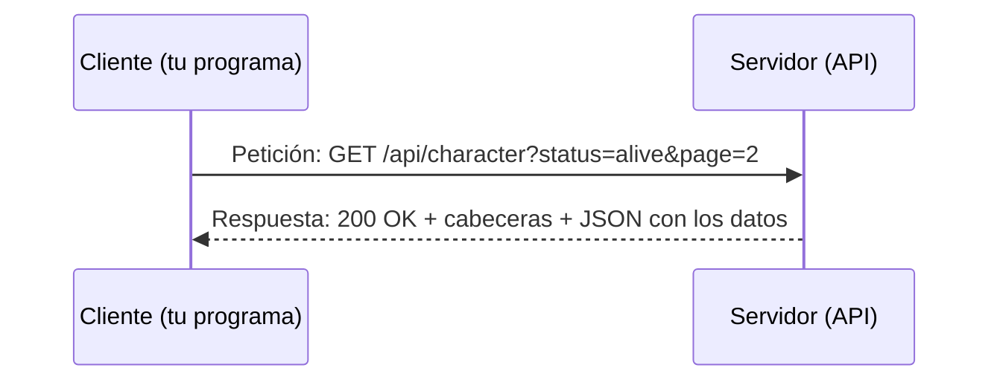

# Manual de APIs REST con Python

**Módulo:** MP5074 – Sistemas de Big Data · Curso 2026-27

> Una **API** es la puerta que un servicio abre para que **otros programas** le pidan datos. Casi todas funcionan sobre **HTTP**, el mismo protocolo que usa el navegador: tu programa envía una **petición** y el servidor contesta con una **respuesta** que lleva un **código de estado** (si ha ido bien o qué ha fallado) y los **datos**, casi siempre en JSON. Este manual explica qué lleva cada petición, qué significan los códigos que devuelve el servidor, cómo es lo que devuelve y cómo convertirlo en un DataFrame con `requests` y pandas. Es la base del [manual de BeautifulSoup](../beautifulsoup/manual_beautifulsoup.md) y del [manual de Selenium](../selenium/manual_selenium.md), que usan las mismas peticiones HTTP.

---

## Índice

1. [Qué es una API](#1-qué-es-una-api)
2. [HTTP: petición y respuesta](#2-http-petición-y-respuesta)
3. [Métodos HTTP](#3-métodos-http)
4. [Códigos de estado](#4-códigos-de-estado)
5. [Cabeceras](#5-cabeceras)
6. [Qué devuelve una API: formatos de respuesta](#6-qué-devuelve-una-api-formatos-de-respuesta)
7. [Primera petición con `requests`](#7-primera-petición-con-requests)
8. [Parámetros de consulta](#8-parámetros-de-consulta)
9. [Enviar datos: POST, PUT, PATCH y DELETE](#9-enviar-datos-post-put-patch-y-delete)
10. [Gestionar errores](#10-gestionar-errores)
11. [Autenticación](#11-autenticación)
12. [Límites de uso y reintentos](#12-límites-de-uso-y-reintentos)
13. [Paginación](#13-paginación)
14. [Guardar en bruto y transformar](#14-guardar-en-bruto-y-transformar)
15. [REST y SOAP](#15-rest-y-soap)
16. [Solución de problemas frecuentes](#16-solución-de-problemas-frecuentes)
17. [Chuleta rápida](#17-chuleta-rápida)
18. [Referencias](#18-referencias)

---

## 1. Qué es una API

**API** (*Application Programming Interface*): una interfaz con reglas fijas para que un programa pida datos o servicios a otro.

> **Analogía.** Una API es la carta de un restaurante. No entras en la cocina (la base de datos del servicio): pides algo que está en la carta, de la forma establecida, y te sirven el plato preparado. Si pides algo que no está en la carta, el camarero te lo dice (un **código de error**).

Descargar un CSV a mano funciona una vez. Si necesitamos la demanda eléctrica de **ayer**, cada día, o el tiempo de 50 ciudades, hace falta que un **programa** pida los datos. Muchas fuentes ofrecen una API: Red Eléctrica (REData), AEMET, INE, Open-Meteo, portales de datos abiertos…

| | API | *Scraping* (BeautifulSoup / Selenium) |
|---|---|---|
| Pensada para | Programas | Personas (la usamos «de prestado») |
| Formato | Estructurado (JSON) | HTML que hay que interpretar |
| Estabilidad | Alta: tiene contrato y documentación | Baja: cambia con el diseño de la web |
| Cuándo | **Siempre que exista** | Cuando no hay API |

Una API web expone **recursos** (personajes, episodios, publicaciones, mediciones…), cada uno en una URL llamada ***endpoint***:

```text
https://rickandmortyapi.com/api/character        ← la lista de personajes
https://rickandmortyapi.com/api/character/1      ← el personaje con id 1
https://rickandmortyapi.com/api/episode          ← la lista de episodios
```

---

## 2. HTTP: petición y respuesta

Siempre hay **dos mensajes**: el cliente (tu programa) envía una **petición** y el servidor (la API) devuelve una **respuesta**.



### 2.1 La URL

```text
https://rickandmortyapi.com/api/character?status=alive&page=2
└─┬─┘   └───────┬─────────┘└─────┬──────┘ └────────┬────────┘
esquema      dominio        ruta (endpoint)   parámetros de consulta
```

| Parte | Ejemplo | Para qué |
|---|---|---|
| Esquema | `https` | Protocolo (con `s`: conexión cifrada) |
| Dominio | `rickandmortyapi.com` | Servidor al que se pide |
| Ruta / *endpoint* | `/api/character` | Qué recurso se pide |
| Parámetros de consulta | `?status=alive&page=2` | Filtros y opciones: pares `clave=valor` separados por `&` |

### 2.2 Qué lleva la petición

| Parte | Qué es | Ejemplo |
|---|---|---|
| **Método** | Qué acción se pide | `GET` (leer) |
| **URL** | Qué recurso, con sus parámetros | `https://…/api/character?page=2` |
| **Cabeceras** | Metadatos: formato aceptado, credenciales, quién pide | `Accept: application/json`, `Authorization: Bearer abc123` |
| **Cuerpo** (*body*) | Datos que se envían (solo en POST, PUT, PATCH) | `{"title": "Hola", "userId": 1}` |

### 2.3 Qué lleva la respuesta

| Parte | Qué es | Ejemplo |
|---|---|---|
| **Código de estado** | Número de 3 cifras con el resultado | `200` (bien), `404` (no existe) |
| **Cabeceras** | Metadatos de la respuesta | `Content-Type: application/json`, `Retry-After: 30` |
| **Cuerpo** | Los datos (o el mensaje de error) | `{"info": {...}, "results": [...]}` |

Puedes ver todo esto en el navegador: `F12` → pestaña **Red** (*Network*) → haz clic en una petición. En **Encabezados** (*Headers*) ves el método, la URL, el código y las cabeceras; en **Respuesta** (*Response*), el cuerpo.

> Las peticiones GET más sencillas se pueden probar **pegando la URL en el navegador**: verás el JSON que devuelve. Prueba con `https://rickandmortyapi.com/api/character/1`.

---

## 3. Métodos HTTP

El **método** indica la acción. Las APIs REST usan los métodos de HTTP sobre los recursos:

| Método | Acción | Ejemplo sobre `/posts` | Lleva cuerpo | Respuesta típica si va bien |
|---|---|---|---|---|
| **GET** | **Leer** | `GET /posts` (todas) · `GET /posts/1` (una) | No | `200 OK` + los datos |
| **POST** | **Crear** | `POST /posts` con los datos de la nueva | Sí | `201 Created` + el recurso creado (con su `id`) |
| **PUT** | **Reemplazar** entero | `PUT /posts/1` con todos los campos | Sí | `200 OK` + el recurso actualizado |
| **PATCH** | **Modificar** algunos campos | `PATCH /posts/1` con `{"title": "Nuevo"}` | Sí | `200 OK` + el recurso actualizado |
| **DELETE** | **Borrar** | `DELETE /posts/1` | No | `200 OK` o `204 No Content` (sin cuerpo) |

En Big Data, para **obtener** datos se usa casi siempre **GET**. Los demás aparecen cuando enviamos datos a un sistema (cargar registros en una base de datos, publicar resultados…).

> **Idempotente**: repetir la petición deja el sistema igual que hacerla una vez. GET, PUT y DELETE lo son; **POST no** (cada POST crea un recurso nuevo). Por eso es seguro reintentar un GET que ha fallado, pero un POST hay que reintentarlo con cuidado.

---

## 4. Códigos de estado

Cada respuesta lleva un **código de estado** de tres cifras. La primera cifra indica la familia:

| Familia | Significado | ¿De quién es el problema? |
|---|---|---|
| **1xx** | Información (casi nunca se ve) | — |
| **2xx** | **Éxito** | Nadie: todo bien |
| **3xx** | **Redirección**: el recurso está en otra URL | Nadie: `requests` la sigue solo |
| **4xx** | **Error del cliente**: tu petición está mal | **Tuyo**: revisa la petición |
| **5xx** | **Error del servidor** | **Del servidor**: espera y reintenta |

Los que más vas a ver, qué devuelven y qué hacer:

| Código | Nombre | Qué significa | Qué suele traer el cuerpo | Qué hacer |
|---|---|---|---|---|
| **200** | OK | La petición ha ido bien | Los datos pedidos | Leer `r.json()` |
| **201** | Created | Se ha creado el recurso (POST) | El recurso creado, con su `id` | Guardar el `id` si lo necesitas |
| **204** | No Content | Bien, pero no hay nada que devolver (DELETE) | **Vacío** | No llamar a `r.json()`: daría error |
| **301 / 302** | Moved / Found | El recurso está en otra URL | — | Nada: `requests` sigue la redirección (`r.history` la muestra) |
| **304** | Not Modified | No ha cambiado desde la última vez (caché) | Vacío | Usar la copia que ya tienes |
| **400** | Bad Request | Petición mal formada: parámetro con nombre o valor incorrecto | Mensaje con el motivo, p. ej. `{"error": true, "reason": "..."}` | Leer el mensaje y corregir los parámetros |
| **401** | Unauthorized | Falta la credencial o no es válida | Mensaje de error | Revisar la clave de API y cómo se envía |
| **403** | Forbidden | Credencial válida, pero **sin permiso** para eso | Mensaje de error | Revisar permisos o el plan contratado; no insistir |
| **404** | Not Found | El recurso no existe (URL mal escrita, `id` inexistente o filtro sin resultados) | A veces un mensaje: `{"error": "There is nothing here"}` | Revisar la URL; en filtros, tratarlo como «0 resultados» |
| **405** | Method Not Allowed | Ese método no se permite en ese endpoint | Mensaje de error | Usar el método que indica la documentación |
| **408** | Request Timeout | El servidor se cansó de esperar tu petición | — | Reintentar |
| **422** | Unprocessable Entity | El cuerpo enviado tiene formato correcto pero datos no válidos | Lista de campos con error | Corregir los datos enviados |
| **429** | Too Many Requests | Has superado el **límite de peticiones** | Mensaje; cabecera `Retry-After` con los segundos de espera | **Esperar** y bajar el ritmo ([sección 12](#12-límites-de-uso-y-reintentos)) |
| **500** | Internal Server Error | Fallo interno del servidor | Página o mensaje genérico | Reintentar más tarde; si persiste, avisar al proveedor |
| **502 / 504** | Bad Gateway / Gateway Timeout | Un servidor intermedio no obtuvo respuesta | Página genérica (a veces HTML, no JSON) | Reintentar con espera |
| **503** | Service Unavailable | Servidor saturado o en mantenimiento | Página genérica; a veces `Retry-After` | Reintentar con espera |

> **Regla práctica:** con un **4xx** el error es **tuyo** (revisa URL, parámetros y clave); reintentar sin cambiar nada no sirve, salvo el **429** (espera). Con un **5xx** el problema es del **servidor**: reintenta pasado un rato.

Muchos errores también traen **cuerpo**: léelo, porque suele explicar exactamente qué está mal.

```python
import requests

r = requests.get("https://rickandmortyapi.com/api/character/99999", timeout=10)   # un id que no existe
r.status_code        # 404
r.reason             # 'Not Found' → el nombre del código
r.ok                 # False → True solo si el código es menor que 400
r.json()             # {'error': 'Character not found'} → el servidor explica el motivo
```

---

## 5. Cabeceras

Las **cabeceras** (*headers*) son pares `Nombre: valor` con información **sobre** la petición o la respuesta.

**Cabeceras de la petición** (las que envías tú):

| Cabecera | Para qué | Ejemplo |
|---|---|---|
| `Accept` | Formato que quieres recibir | `application/json` |
| `Content-Type` | Formato del cuerpo que envías (POST, PUT) | `application/json` |
| `Authorization` | Credencial | `Bearer eyJhbGciOi...` |
| `User-Agent` | Quién hace la petición | `MP5074-practicas (IES Fernando Wirtz)` |
| Propias de la API | Algunas piden la clave en una cabecera con otro nombre | `x-api-key: abc123` |

**Cabeceras de la respuesta** (las que envía el servidor):

| Cabecera | Para qué | Ejemplo |
|---|---|---|
| `Content-Type` | Formato del cuerpo recibido | `application/json; charset=utf-8` |
| `Content-Length` | Tamaño del cuerpo en bytes | `1534` |
| `Retry-After` | Cuántos segundos esperar (con 429 o 503) | `30` |
| `X-RateLimit-Limit` / `X-RateLimit-Remaining` | Límite de peticiones y cuántas te quedan (no todas las APIs) | `100` / `87` |
| `Location` | URL del recurso creado (201) o de la redirección (3xx) | `/posts/101` |

```python
r = requests.get("https://rickandmortyapi.com/api/character/1", timeout=10)
r.headers["Content-Type"]                      # 'application/json; charset=utf-8'
r.headers.get("X-RateLimit-Remaining")         # None si la API no la envía (get no da error)
r.request.headers                              # las cabeceras que envió tu petición
```

`r.headers` no distingue mayúsculas: `r.headers["content-type"]` también funciona.

---

## 6. Qué devuelve una API: formatos de respuesta

Casi todas las APIs devuelven **JSON**, que `r.json()` convierte en diccionarios y listas de Python. Lo importante es localizar **dónde está la lista de registros** que será la tabla. Estas son las formas más habituales:

**Forma 1 — Una lista de registros.** Cada elemento es una fila:

```python
datos = [                                       # lo que devolvería GET /posts
    {"id": 1, "userId": 1, "title": "Primer post"},
    {"id": 2, "userId": 1, "title": "Segundo post"},
]
import pandas as pd
pd.DataFrame(datos)                             # directamente: una fila por diccionario
```

**Forma 2 — Metadatos + lista de registros.** Muy habitual en listados paginados:

```python
datos = {                                       # lo que devuelve GET /api/episode (Rick & Morty)
    "info": {"count": 51, "pages": 3, "next": "https://rickandmortyapi.com/api/episode?page=2", "prev": None},
    "results": [
        {"id": 1, "name": "Pilot", "air_date": "December 2, 2013", "episode": "S01E01"},
        {"id": 2, "name": "Lawnmower Dog", "air_date": "December 9, 2013", "episode": "S01E02"},
    ],
}
datos["info"]["count"]                          # metadatos: cuántos hay en total
pd.DataFrame(datos["results"])                  # la tabla está en "results"
```

**Forma 3 — Diccionario de listas** (una lista por columna, todas de la misma longitud). Lo usa Open-Meteo:

```python
datos = {
    "latitude": 43.37, "longitude": -8.40,                      # metadatos
    "daily_units": {"temperature_2m_max": "°C"},                # unidades de cada variable
    "daily": {
        "time": ["2025-01-01", "2025-01-02", "2025-01-03"],
        "temperature_2m_max": [13.1, 12.4, 11.8],
    },
}
pd.DataFrame(datos["daily"])                    # cada clave es una columna
```

**Forma 4 — JSON anidado.** Los registros están varios niveles más abajo. Ejemplo con la forma de REData (Red Eléctrica):

```python
datos = {
    "data": {"type": "Demanda", "attributes": {"title": "Demanda"}},
    "included": [                                               # una entrada por serie
        {"type": "Demanda", "attributes": {"title": "Demanda", "values": [
            {"value": 712345.6, "percentage": 1, "datetime": "2025-01-01T00:00:00.000+01:00"},
            {"value": 798120.3, "percentage": 1, "datetime": "2025-01-02T00:00:00.000+01:00"},
        ]}},
    ],
}
# camino hasta los registros: included → cada elemento → attributes → values
demanda = pd.json_normalize(
    datos["included"],
    record_path=["attributes", "values"],       # la lista que se convierte en filas
    meta=[["attributes", "title"]],             # dato del nivel superior que se repite en cada fila
)
demanda                                         # columnas: value, percentage, datetime, attributes.title
```

Si cada registro tiene **diccionarios dentro**, `pd.json_normalize(lista)` los aplana en columnas con punto (`author.name`). Es lo que se explica en la sección 4.3 del [manual de pandas](../pandas/manual_pandas.md).

**Otros formatos.** Algunas APIs devuelven **CSV** (`pd.read_csv(StringIO(r.text))`) o **XML** (`pd.read_xml(StringIO(r.text))`). Mira siempre `r.headers["Content-Type"]` para saber qué te ha llegado.

> **Método para cualquier API nueva:** haz **una** petición pequeña y explora antes de convertir: `datos.keys()` si es un diccionario, `len(datos)` y `datos[0]` si es una lista. Dibuja el camino hasta la lista de registros.

---

## 7. Primera petición con `requests`

```bash
conda activate bigdata
conda install -c conda-forge requests
```

```python
import requests

r = requests.get("https://rickandmortyapi.com/api/character/1", timeout=10)   # GET a un recurso
```

`r` es un objeto **respuesta** (`Response`). Lo que puedes consultar:

| Atributo / método | Devuelve | Ejemplo |
|---|---|---|
| `r.status_code` | Código de estado | `200` |
| `r.ok` | `True` si el código es < 400 | `True` |
| `r.reason` | Nombre del código | `'OK'` |
| `r.url` | URL final, con los parámetros codificados | `'https://…/character/1'` |
| `r.headers` | Cabeceras de la respuesta (como diccionario) | `r.headers["Content-Type"]` |
| `r.text` | Cuerpo como **texto** | `'{"id":1,"name":"Rick Sanchez",…}'` |
| `r.content` | Cuerpo como **bytes** (imágenes, ficheros, ZIP) | `b'{"id":1,…'` |
| `r.json()` | Cuerpo convertido a diccionario / lista | `{'id': 1, 'name': 'Rick Sanchez', …}` |
| `r.encoding` | Codificación usada para `r.text` | `'utf-8'` |
| `r.elapsed` | Cuánto tardó la respuesta | `datetime.timedelta(microseconds=152000)` |
| `r.history` | Redirecciones seguidas (lista de respuestas 3xx) | `[]` |
| `r.request` | La petición que se envió (método, URL, cabeceras) | `r.request.method` → `'GET'` |

```python
r.status_code, r.reason              # (200, 'OK')
r.headers["Content-Type"]            # 'application/json; charset=utf-8' → es JSON
personaje = r.json()                 # texto JSON → diccionario de Python
personaje["name"], personaje["status"], personaje["species"]   # ('Rick Sanchez', 'Alive', 'Human')
personaje["origin"]["name"]          # campo anidado: un diccionario dentro de otro
len(personaje["episode"])            # lista con las URL de los episodios en que aparece
```

> **Pon siempre `timeout=`.** Sin él, si el servidor no responde, tu programa se queda esperando **para siempre**. Con `timeout=10`, a los 10 s lanza `requests.Timeout`.

---

## 8. Parámetros de consulta

Los filtros y opciones van tras el `?` de la URL. Con `requests` se pasan en un diccionario con **`params=`**, y él se encarga de construir y codificar la URL (espacios, tildes, comas, barras…):

```python
r = requests.get(
    "https://rickandmortyapi.com/api/character",
    params={"name": "rick", "status": "alive"},    # → ?name=rick&status=alive
    timeout=10,
)
r.url                                              # 'https://rickandmortyapi.com/api/character?name=rick&status=alive'
r.json()["info"]["count"]                          # cuántos personajes cumplen el filtro
```

```python
URL_METEO = "https://archive-api.open-meteo.com/v1/archive"
params = {
    "latitude": 43.37, "longitude": -8.40,                           # A Coruña
    "start_date": "2025-01-01", "end_date": "2025-01-31",
    "daily": "temperature_2m_max,temperature_2m_min,precipitation_sum",
    "timezone": "Europe/Madrid",
}
r = requests.get(URL_METEO, params=params, timeout=10)
r.url        # …&daily=temperature_2m_max%2Ctemperature_2m_min…&timezone=Europe%2FMadrid
             # requests ha codificado las comas (%2C) y la barra (%2F) por nosotros

clima = pd.DataFrame(r.json()["daily"])            # forma 3: diccionario de listas
clima["time"] = pd.to_datetime(clima["time"])
clima.shape                                        # (31, 4) → un día por fila
```

Qué parámetros admite cada endpoint (nombres, valores, formato de fechas) lo dice **su documentación**. Si un parámetro está mal, la API suele contestar **400** explicando el motivo:

```python
r = requests.get(URL_METEO, params={**params, "daily": "temperatura_maxima"}, timeout=10)   # variable que no existe
r.status_code                                      # 400 → el error es nuestro
r.json()                                           # {'error': True, 'reason': '… invalid String value temperatura_maxima …'}
```

---

## 9. Enviar datos: POST, PUT, PATCH y DELETE

Para probar los métodos que **cambian** datos usamos **JSONPlaceholder** (`jsonplaceholder.typicode.com`), una API de pruebas que responde como si guardara los cambios, aunque **no guarda nada**.

```python
API = "https://jsonplaceholder.typicode.com"

# GET: leer
r = requests.get(f"{API}/posts/1", timeout=10)
r.status_code, r.json()["title"]                   # 200 y el título de la publicación 1

# POST: crear. json= convierte el diccionario a JSON y añade la cabecera Content-Type: application/json
nuevo = {"title": "Mi publicación", "body": "Texto de prueba", "userId": 1}
r = requests.post(f"{API}/posts", json=nuevo, timeout=10)
r.status_code                                      # 201 Created
r.json()                                           # lo que se creó, con el id que le asignó el servidor (101)

# PUT: reemplazar el recurso completo
r = requests.put(f"{API}/posts/1", json={"id": 1, "title": "Otro título", "body": "…", "userId": 1}, timeout=10)
r.status_code                                      # 200

# PATCH: cambiar solo algunos campos
r = requests.patch(f"{API}/posts/1", json={"title": "Solo cambio el título"}, timeout=10)
r.status_code, r.json()["title"]                   # 200, 'Solo cambio el título'

# DELETE: borrar
r = requests.delete(f"{API}/posts/1", timeout=10)
r.status_code                                      # 200 (otras APIs devuelven 204, sin cuerpo)
```

| Parámetro de `requests` | Envía el cuerpo como | Cuándo |
|---|---|---|
| `json=diccionario` | JSON (`Content-Type: application/json`) | Lo normal con APIs REST |
| `data=diccionario` | Formulario (`application/x-www-form-urlencoded`) | Formularios web, algunas APIs antiguas |
| `files={"f": open(...)}` | Fichero (`multipart/form-data`) | Subir ficheros |

---

## 10. Gestionar errores

Dos tipos de fallo:

1. **El servidor responde, pero con error** (4xx, 5xx). `requests` **no** lanza excepción por sí solo: hay que mirar `r.status_code` o llamar a **`r.raise_for_status()`**, que lanza `HTTPError` si el código es 4xx o 5xx.
2. **No hay respuesta**: sin conexión, el dominio no existe, o se agota el `timeout`. Aquí `requests` sí lanza una excepción.

| Excepción | Cuándo |
|---|---|
| `requests.HTTPError` | `raise_for_status()` con un código 4xx o 5xx |
| `requests.Timeout` | El servidor no respondió en el tiempo de `timeout` |
| `requests.ConnectionError` | No se pudo conectar (sin red, dominio mal escrito, servidor caído) |
| `requests.JSONDecodeError` | `r.json()` con un cuerpo que no es JSON (una página HTML de error, cuerpo vacío) |
| `requests.RequestException` | **La madre de todas**: captura cualquiera de las anteriores |

Patrón recomendado: una función que descarga, comprueba y devuelve los datos, o `None` si falla:

```python
def pedir_json(url, params=None):
    """GET a url. Devuelve el JSON como dict/list, o None si algo falla (y explica por qué)."""
    try:
        r = requests.get(url, params=params, timeout=10)
        r.raise_for_status()                     # 4xx / 5xx → HTTPError
        return r.json()                          # cuerpo no JSON → JSONDecodeError (hija de RequestException)
    except requests.HTTPError as e:
        print(f"Error HTTP {e.response.status_code}: {e.response.text[:200]}")   # el código y el mensaje del servidor
    except requests.RequestException as e:
        print(f"Fallo de red o de formato: {e}")
    return None

pedir_json("https://rickandmortyapi.com/api/character", {"name": "nadie-se-llama-asi"})
# Error HTTP 404: {"error":"There is nothing here"}  → en esta API, un filtro sin resultados da 404
```

> Antes de `r.json()`, comprueba que la respuesta es JSON: si el servidor está caído, a veces devuelve una **página HTML** de error con código 502 o 503.

---

## 11. Autenticación

Muchas APIs exigen identificarse para controlar quién las usa y cuánto. La documentación dice **cómo** enviar la credencial:

| Forma | Cómo se envía | Ejemplo en `requests` |
|---|---|---|
| Clave en un parámetro | `?api_key=abc123` | `params={"api_key": clave}` |
| Clave en una cabecera propia | `api_key: abc123` o `x-api-key: abc123` | `headers={"api_key": clave}` |
| Token *Bearer* | `Authorization: Bearer abc123` | `headers={"Authorization": f"Bearer {clave}"}` |
| Usuario y contraseña (*Basic*) | `Authorization: Basic …` | `auth=("usuario", "contraseña")` |
| OAuth | Flujo con varias peticiones para obtener un token | Librerías específicas (redes sociales, Google…) |

Si la credencial falta o es incorrecta: **401**. Si es correcta pero no tiene permiso para ese recurso: **403**.

> ⚠️ **La clave no se escribe en el código.** Si subes el notebook a GitHub, cualquiera podrá usarla. Guárdala en una **variable de entorno** o en un fichero `.env` que esté en `.gitignore`:

```py
import os
clave = os.environ["AEMET_API_KEY"]            # definida antes en el sistema o en el entorno conda
r = requests.get(url, headers={"api_key": clave}, timeout=10)
```

Con el fichero `.env` (`AEMET_API_KEY=abc123`) y la librería `python-dotenv`:

```py
from dotenv import load_dotenv
load_dotenv()                                   # lee .env y crea las variables de entorno
clave = os.environ["AEMET_API_KEY"]
```

---

## 12. Límites de uso y reintentos

Las APIs limitan cuántas peticiones puedes hacer por segundo, minuto o día (*rate limit*). Si lo superas, recibes un **429 Too Many Requests**, a menudo con la cabecera **`Retry-After`** (segundos que debes esperar).

Buenas prácticas:

- **Pausa** entre peticiones dentro de un bucle: `time.sleep(0.5)`.
- **No pidas dos veces lo mismo**: guarda lo descargado ([sección 14](#14-guardar-en-bruto-y-transformar)).
- **Reintenta** los fallos temporales (429, 500, 502, 503, 504) con **espera creciente**; nunca los 4xx que indican que tu petición está mal.

Reintentos escritos a mano:

```python
import time

def pedir_con_reintentos(url, params=None, intentos=4):
    """GET con reintentos para errores temporales. Respeta Retry-After si el servidor lo envía."""
    for intento in range(1, intentos + 1):
        try:
            r = requests.get(url, params=params, timeout=10)
        except (requests.Timeout, requests.ConnectionError) as e:
            print(f"Intento {intento}: sin respuesta ({e.__class__.__name__})")
        else:
            if r.status_code not in (429, 500, 502, 503, 504):   # éxito o error definitivo: no reintentar
                r.raise_for_status()                            # un 400/401/404 aquí lanza HTTPError
                return r.json()
            print(f"Intento {intento}: código {r.status_code}")
            espera = r.headers.get("Retry-After")
            if espera and espera.isdigit():                     # el servidor dice cuánto esperar
                time.sleep(int(espera))
                continue
        time.sleep(2 ** intento)                                # espera creciente: 2, 4, 8, 16 s
    raise RuntimeError(f"Sin éxito tras {intentos} intentos: {url}")
```

Lo mismo, de forma más compacta, con una **sesión** configurada para reintentar sola:

```python
from requests.adapters import HTTPAdapter
from urllib3.util.retry import Retry

sesion = requests.Session()                                  # reutiliza la conexión: más rápido en bucles
reintentos = Retry(
    total=4,                                                 # como máximo 4 reintentos
    backoff_factor=1,                                        # esperas crecientes entre intentos
    status_forcelist=[429, 500, 502, 503, 504],              # códigos que merece la pena reintentar
    allowed_methods=["GET"],                                 # solo GET (idempotente)
)
sesion.mount("https://", HTTPAdapter(max_retries=reintentos))   # aplicar a todas las URL https
sesion.headers["User-Agent"] = "MP5074-practicas (IES Fernando Wirtz)"   # cabecera para todas las peticiones

r = sesion.get("https://rickandmortyapi.com/api/episode", timeout=10)    # se usa igual que requests.get
r.status_code
```

`Retry` respeta `Retry-After` automáticamente. Una **sesión** (`requests.Session`) además mantiene las cabeceras y la conexión abierta entre peticiones, lo que acelera mucho los bucles.

---

## 13. Paginación

Si un resultado tiene miles de registros, la API no los manda de golpe: los reparte en **páginas**. Hay tres estilos:

| Estilo | Cómo se pide la siguiente | Cómo sé que he terminado | Ejemplo |
|---|---|---|---|
| **Número de página** | `?page=2`, `?page=3`… | Página vacía, o llego a `pages` | Rick & Morty, quotes.toscrape.com/api |
| **Desplazamiento** | `?offset=100&limit=50` | Llegan menos de `limit` registros | Muchos portales de datos abiertos |
| **Enlace o cursor** | La respuesta trae la URL o el *token* de la siguiente (`"next": "https://…"`) | `next` es `None` | Rick & Morty, APIs grandes |

**Siguiendo el enlace `next`** (el más cómodo cuando existe):

```python
def descargar_todo(url):
    """Recorre todas las páginas siguiendo info.next. Devuelve la lista de todos los registros."""
    registros = []
    while url:                                   # None en la última página → el bucle termina
        pagina = pedir_con_reintentos(url)
        registros.extend(pagina["results"])      # los registros de esta página
        url = pagina["info"]["next"]             # URL de la siguiente (ya trae ?page=N)
        time.sleep(0.5)                          # pausa de cortesía
    return registros

episodios = descargar_todo("https://rickandmortyapi.com/api/episode")
len(episodios)                                   # 51 → debe coincidir con info.count
```

**Por desplazamiento** (patrón general, para una API que admita `offset` y `limit`):

```py
registros, offset, limite = [], 0, 100
while True:
    lote = pedir_json(URL, {"offset": offset, "limit": limite})   # registros del offset al offset+100
    registros.extend(lote)
    if len(lote) < limite:                       # han llegado menos de 100: era la última página
        break
    offset += limite                             # la siguiente empieza 100 registros más allá
    time.sleep(0.5)
```

> **Comprueba siempre el total**: si la API dice `count: 51`, tu lista debe tener 51 elementos. Si sale 20 o 40, el bucle se ha cortado antes de tiempo. Comprueba también que no hay duplicados.

---

## 14. Guardar en bruto y transformar

Buena práctica de ingeniería de datos: **guardar la respuesta tal cual** (*raw*) antes de transformarla. Si la transformación tiene un error, la corriges y la vuelves a ejecutar sobre los ficheros guardados, **sin volver a llamar a la API** (que es lenta, tiene límites y puede cambiar sus datos).

```python
import json
from pathlib import Path

RAW = Path("datos/raw")                          # capa en bruto: lo que devolvió la API
PROCESADOS = Path("datos/procesados")            # capa limpia: tablas listas para analizar
RAW.mkdir(parents=True, exist_ok=True)
PROCESADOS.mkdir(parents=True, exist_ok=True)

# 1. Descargar y guardar en bruto
with open(RAW / "episodios.json", "w", encoding="utf-8") as f:
    json.dump(episodios, f, ensure_ascii=False)  # ensure_ascii=False: guarda las tildes tal cual

# 2. Transformar (se puede repetir sin llamar a la API)
with open(RAW / "episodios.json", encoding="utf-8") as f:
    datos = json.load(f)

ep = pd.DataFrame(datos)
ep["n_personajes"] = ep["characters"].str.len()                         # cada episodio trae una lista de URL de personajes
ep["temporada"] = ep["episode"].str[1:3].astype(int)                   # 'S01E01' → 1
ep["fecha_emision"] = pd.to_datetime(ep["air_date"], format="%B %d, %Y")   # 'December 2, 2013' (mes en inglés)
ep = ep[["id", "name", "temporada", "fecha_emision", "n_personajes"]]

# 3. Guardar la tabla limpia
ep.to_parquet(PROCESADOS / "episodios.parquet", index=False)
ep.groupby("temporada").agg(episodios=("id", "count"), personajes_medio=("n_personajes", "mean")).round(1)
```

**Fechas con zona horaria.** Algunas APIs devuelven fechas con desfase (`"2025-01-01T00:00:00.000+01:00"`, y `+02:00` en verano). Con `pd.to_datetime(..., utc=True)` se convierten todas a UTC, y `.dt.tz_convert("Europe/Madrid")` las devuelve a hora peninsular (sección 15.5 del [manual de pandas](../pandas/manual_pandas.md)).

```python
demanda["fecha"] = pd.to_datetime(demanda["datetime"], utc=True).dt.tz_convert("Europe/Madrid")
demanda[["fecha", "value"]]                      # la demanda de la sección 6, con fechas de verdad
```

---

## 15. REST y SOAP

| | **REST** | **SOAP** |
|---|---|---|
| Qué es | Un **estilo** de arquitectura | Un **protocolo** con reglas estrictas |
| Recursos | Cada recurso tiene su URL (`/character/1`) | Un único punto de entrada; la operación va dentro del mensaje |
| Métodos | Los de HTTP (GET, POST, PUT, DELETE…) | Casi siempre POST |
| Formato | Normalmente **JSON** | Siempre **XML** (un «sobre» SOAP) |
| Contrato | Documentación (a menudo OpenAPI / Swagger) | Fichero **WSDL** que describe las operaciones |
| Uso hoy | La gran mayoría de APIs públicas | Banca, administraciones, sistemas antiguos |

Una API REST es **sin estado** (*stateless*): cada petición lleva todo lo necesario para responderla y el servidor no recuerda las anteriores. Eso permite repartir las peticiones entre muchos servidores, la misma idea de escalar que buscamos en Big Data.

Así es una petición SOAP (solo para reconocerla; en Python se usa la librería `zeep`):

```xml
<soap:Envelope xmlns:soap="http://schemas.xmlsoap.org/soap/envelope/">
  <soap:Body>
    <ObtenerTemperatura><ciudad>A Coruña</ciudad></ObtenerTemperatura>
  </soap:Body>
</soap:Envelope>
```

---

## 16. Solución de problemas frecuentes

| Problema | Causa probable | Solución |
|---|---|---|
| El programa se queda colgado | Falta `timeout` y el servidor no responde | `timeout=10` en todas las peticiones |
| `JSONDecodeError` al llamar a `r.json()` | El cuerpo no es JSON (página HTML de error, cuerpo vacío por un 204) | Mira `r.status_code` y `r.text[:300]` antes; comprueba `r.headers["Content-Type"]` |
| **400** Bad Request | Nombre o valor de un parámetro incorrecto, formato de fecha | Lee el mensaje del cuerpo (`r.text`) y la documentación |
| **401** Unauthorized | Falta la clave o es incorrecta | Revisa la clave y **cómo** se envía (parámetro o cabecera) |
| **403** Forbidden | Sin permiso para ese recurso o plan | Revisa permisos; no reintentes |
| **404** Not Found | URL mal escrita, `id` inexistente, o un filtro sin resultados | Comprueba `r.url`; en filtros, trátalo como «0 resultados» |
| **429** Too Many Requests | Demasiadas peticiones seguidas | Pausas más largas, respeta `Retry-After`, reintentos con espera |
| **5xx** | Fallo del servidor | Reintenta más tarde con espera creciente |
| Faltan registros tras paginar | El bucle terminó antes (condición de fin mal) | Compara con el total que da la API (`count`) |
| Tildes como `é` en `r.text` | Codificación mal detectada | `r.encoding = "utf-8"` antes de `r.text` (`r.json()` suele acertar) |
| `ConnectionError` | Sin red, dominio mal escrito, proxy o cortafuegos | Abre la URL en el navegador para comprobarlo |

---

## 17. Chuleta rápida

```py
import requests, time, json
import pandas as pd

# ---------- Peticiones ----------
r = requests.get(url, params={"page": 2}, headers={"Accept": "application/json"}, timeout=10)
requests.post(url, json={...}, timeout=10);  requests.put(...);  requests.patch(...);  requests.delete(...)

# ---------- Respuesta ----------
r.status_code;  r.ok;  r.reason;  r.url;  r.headers["Content-Type"];  r.text;  r.json();  r.elapsed

# ---------- Errores ----------
try:
    r = requests.get(url, timeout=10); r.raise_for_status(); datos = r.json()
except requests.RequestException as e:
    print(e)

# ---------- Autenticación ----------
headers={"Authorization": f"Bearer {os.environ['CLAVE']}"};  params={"api_key": clave};  auth=("usuario", "clave")

# ---------- Paginación ----------
while url:
    p = requests.get(url, timeout=10).json(); todos.extend(p["results"]); url = p["info"]["next"]; time.sleep(0.5)

# ---------- A pandas ----------
pd.DataFrame(lista);  pd.DataFrame(dict_de_listas);  pd.json_normalize(datos, record_path=[...], meta=[...])

# Códigos: 200 OK · 201 Created · 204 sin cuerpo · 400 petición mal · 401 sin clave · 403 sin permiso
#          404 no existe · 429 demasiadas peticiones · 5xx fallo del servidor (reintentar)
```

---

## 18. Referencias

- Documentación de `requests`: [requests.readthedocs.io](https://requests.readthedocs.io/)
- Códigos de estado HTTP (MDN): [developer.mozilla.org/es/docs/Web/HTTP/Status](https://developer.mozilla.org/es/docs/Web/HTTP/Status)
- Métodos HTTP (MDN): [developer.mozilla.org/es/docs/Web/HTTP/Methods](https://developer.mozilla.org/es/docs/Web/HTTP/Methods)
- Cabeceras HTTP (MDN): [developer.mozilla.org/es/docs/Web/HTTP/Headers](https://developer.mozilla.org/es/docs/Web/HTTP/Headers)
- APIs para practicar: [Rick and Morty API](https://rickandmortyapi.com/documentation), [JSONPlaceholder](https://jsonplaceholder.typicode.com/), [Open-Meteo](https://open-meteo.com/en/docs/historical-weather-api)
- REData, API de Red Eléctrica: [ree.es/es/datos/apidatos](https://www.ree.es/es/datos/apidatos)
- [Manual de pandas](../pandas/manual_pandas.md) · [Manual de BeautifulSoup](../beautifulsoup/manual_beautifulsoup.md) · [Manual de Selenium](../selenium/manual_selenium.md)
