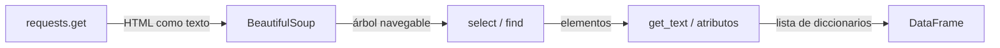
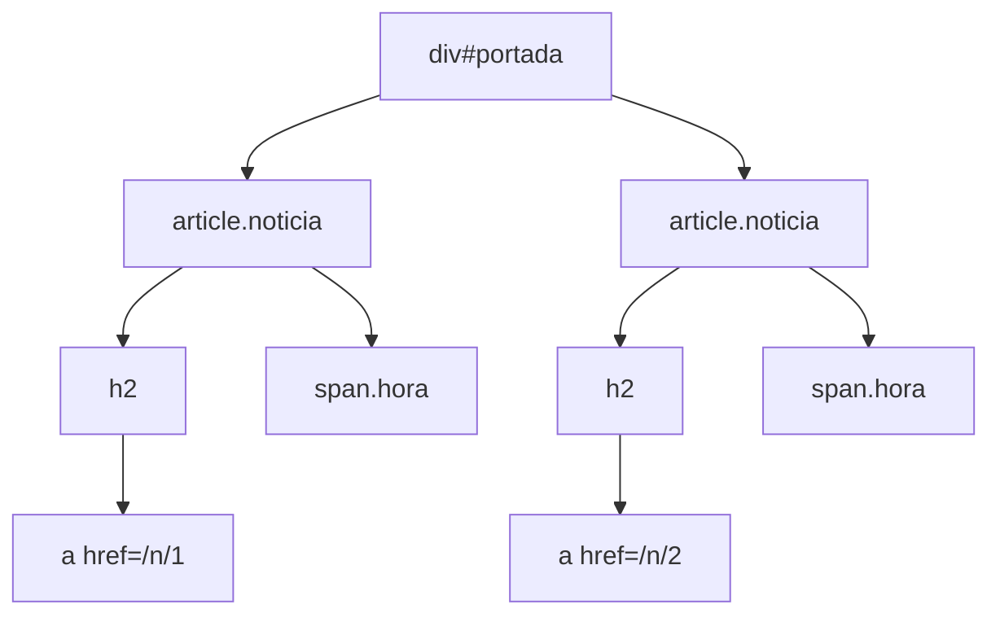

# Manual de BeautifulSoup para web scraping

**Módulo:** MP5074 – Sistemas de Big Data · Curso 2026-27

> Muchos datos públicos solo están en **páginas web pensadas para personas**: titulares, tablas de un portal de transparencia, precios de una tienda. El ***web scraping*** consiste en descargar esas páginas con un programa y **extraer** los datos automáticamente. Este manual explica cómo está construida una página (HTML, árbol DOM y selectores CSS), cómo descargarla con `requests`, cómo extraer los datos con **BeautifulSoup** y cómo hacerlo con muchas páginas de forma limpia, robusta y respetuosa. Para las páginas que cargan los datos con JavaScript, consulta el [manual de Selenium](../selenium/manual_selenium.md).

---

## Índice

1. [Web scraping: cuándo y para qué](#1-web-scraping-cuándo-y-para-qué)
2. [HTML: etiquetas y atributos](#2-html-etiquetas-y-atributos)
3. [El árbol DOM](#3-el-árbol-dom)
4. [Herramientas de desarrollador del navegador](#4-herramientas-de-desarrollador-del-navegador)
5. [Selectores CSS](#5-selectores-css)
6. [Instalación y primera «sopa»](#6-instalación-y-primera-sopa)
7. [Localizar elementos](#7-localizar-elementos)
8. [Extraer la información](#8-extraer-la-información)
9. [Enlaces relativos: `urljoin`](#9-enlaces-relativos-urljoin)
10. [Descargar páginas reales con `requests`](#10-descargar-páginas-reales-con-requests)
11. [Recorrer varias páginas](#11-recorrer-varias-páginas)
12. [Tablas: `pandas.read_html`](#12-tablas-pandasread_html)
13. [Limpiar el texto extraído](#13-limpiar-el-texto-extraído)
14. [`robots.txt` y scraping responsable](#14-robotstxt-y-scraping-responsable)
15. [Un scraper robusto: sesión, caché y reintentos](#15-un-scraper-robusto-sesión-caché-y-reintentos)
16. [Solución de problemas frecuentes](#16-solución-de-problemas-frecuentes)
17. [Chuleta rápida](#17-chuleta-rápida)
18. [Referencias](#18-referencias)

---

## 1. Web scraping: cuándo y para qué

| Fuente | Cómo se obtienen los datos | Cuándo |
|---|---|---|
| **Fichero** (CSV, Excel, JSON…) | Se descarga y se lee con pandas | Siempre que exista: es lo más sencillo |
| **API** | `requests` + JSON | Si la web ofrece una: es estable, rápida y está pensada para programas |
| ***Scraping* de página estática** | `requests` + **BeautifulSoup** | Cuando los datos solo están en el HTML de la página |
| ***Scraping* de página dinámica** | Selenium (+ BeautifulSoup) | Cuando los datos los pinta un JavaScript |

El *scraping* es el **último recurso** antes de Selenium: depende del diseño de la página, que puede cambiar en cualquier momento. Si hay fichero o API, úsalos.

El proceso de *scraping* estático tiene siempre los mismos pasos:



---

## 2. HTML: etiquetas y atributos

**HTML** (*HyperText Markup Language*) describe el contenido de una página con **etiquetas**:

```html
<a href="https://www.ine.es" class="enlace externo" id="ine">Instituto Nacional de Estadística</a>
```

- `<a>` es la **etiqueta de apertura** y `</a>` la de **cierre**. Lo que hay entre ellas es el **contenido** (texto u otras etiquetas).
- `href`, `class` e `id` son **atributos**: información adicional con la forma `nombre="valor"`.
- Algunas etiquetas no tienen cierre: ``, `<br>`.

| Etiqueta | Uso | Qué suele interesar |
|---|---|---|
| `<h1>`…`<h6>` | Títulos | El texto |
| `<p>` | Párrafo | El texto |
| `<a>` | Enlace | El texto y el atributo `href` |
| `` | Imagen | `src` y `alt` |
| `<ul>`, `<ol>`, `<li>` | Listas | Cada `<li>` |
| `<table>`, `<tr>`, `<th>`, `<td>` | Tabla, fila, celda de cabecera, celda | Las celdas |
| `<div>`, `<span>` | Contenedores genéricos (bloque / en línea) | Su `class` o `id` para localizarlos |
| `<article>`, `<section>`, `<nav>` | Contenedores con significado | Agrupan noticias, menús… |

**`id` y `class`: los ganchos.** Los diseñadores web los usan para dar estilo, y nosotros para **encontrar** los elementos:

- **`id`**: identificador **único** en la página (`id="precio-total"`).
- **`class`**: una o varias clases separadas por espacios, **compartidas** por muchos elementos (`class="noticia destacada"`). Todas las noticias de una portada suelen tener la misma clase: eso permite extraerlas todas de una vez.

---

## 3. El árbol DOM

El navegador convierte el HTML en un **árbol** llamado **DOM** (*Document Object Model*). Cada etiqueta es un **nodo**:

```html
<div id="portada">
  <article class="noticia">
    <h2><a href="/n/1">Récord de visitantes</a></h2>
    <span class="hora">10:15</span>
  </article>
  <article class="noticia">
    <h2><a href="/n/2">Nuevo puerto seco</a></h2>
    <span class="hora">09:40</span>
  </article>
</div>
```



| Relación | Ejemplo |
|---|---|
| **Padre** | `article` es padre de `h2` |
| **Hijos** | `h2` y `span` son hijos de `article` |
| **Descendientes** | el `a` es descendiente de `div#portada` (hijo, nieto…) |
| **Hermanos** | los dos `article` (mismo padre) |

Cada noticia es un `article` con la **misma estructura interna**. Esta repetición es la clave del *scraping*: se localiza el **bloque que se repite** y, dentro de cada uno, los **campos**.

---

## 4. Herramientas de desarrollador del navegador

Todos los navegadores las incluyen: `F12` o clic derecho → **Inspeccionar**.

| Pestaña | Para qué |
|---|---|
| **Elementos** | Ver el árbol DOM. Con la flecha (`Ctrl+Mayús+C`) haces clic en algo de la página y te lleva a su etiqueta |
| **Red** (*Network*) | Ver las peticiones de la página. Filtra por **Fetch/XHR**: si los datos llegan en JSON desde una API oculta, usa esa API |
| **Consola** | Probar selectores: `document.querySelectorAll("article.noticia h2 a").length` |

> ⚠️ **Código fuente frente a DOM.** *Ver código fuente* (`Ctrl+U`) muestra el HTML **tal como lo envía el servidor**: es lo que descargará `requests`. *Inspeccionar* muestra el DOM **después** de ejecutar el JavaScript. Si un dato aparece al inspeccionar pero no en el código fuente, la página es dinámica y necesitarás [Selenium](../selenium/manual_selenium.md).

---

## 5. Selectores CSS

Un **selector CSS** describe qué elementos del DOM quieres. Nació para aplicar estilos, y BeautifulSoup (y Selenium) lo usan para seleccionar.

| Selector | Selecciona | Ejemplo |
|---|---|---|
| `etiqueta` | Todos los de esa etiqueta | `h2` |
| `.clase` | Los que tienen esa clase | `.noticia` |
| `#id` | El que tiene ese id | `#portada` |
| `etiqueta.clase` | Esa etiqueta con esa clase | `article.noticia` |
| `.a.b` | Con las dos clases a la vez | `.noticia.destacada` |
| `A B` (espacio) | B **descendiente** de A (a cualquier profundidad) | `article h2 a` |
| `A > B` | B **hijo directo** de A | `article > span` |
| `[atributo]` | Que tiene el atributo | `a[href]` |
| `[atributo="valor"]` | Con ese valor exacto | `a[target="_blank"]` |
| `[atributo^="valor"]` | Que **empieza** por el valor | `a[href^="/n/"]` |
| `:nth-child(n)` | El que ocupa la posición *n* entre sus hermanos | `tr td:nth-child(2)` |
| `:has(X)` | Que contiene un X | `tr:has(td)` |

Un buen selector es **específico** (no atrapa elementos que no quieres) y **robusto** (no depende de detalles que cambian, como la posición exacta o clases generadas automáticamente del tipo `css-1x9k2a`).

---

## 6. Instalación y primera «sopa»

```bash
conda activate bigdata
conda install -c conda-forge requests beautifulsoup4 lxml
```

Para aprender sin depender de Internet, empezamos con un HTML escrito en el propio código: el ranking de atletismo de un club, con dos tablas.

```python
from bs4 import BeautifulSoup

html = """
<main>
  <h1>Ranking 2025 – 1500 m</h1>
  <table class="ranking" id="absoluta">
    <tr><th>Pos.</th><th>Atleta</th><th>Marca</th></tr>
    <tr><td>1</td><td><a href="/atletas/45">Iria Pena</a></td><td>4:12.30</td></tr>
  </table>
  <table class="ranking" id="sub20">
    <tr><th>Pos.</th><th>Atleta</th><th>Marca</th></tr>
    <tr class="fila"><td>1</td><td><a href="/atletas/88">Noa Castro</a></td><td>4:21.05</td></tr>
    <tr class="fila"><td>2</td><td><a href="/atletas/91">Uxía Rey</a></td><td>  4:24.70 </td></tr>
  </table>
</main>
"""

sopa = BeautifulSoup(html, "html.parser")   # convierte el texto en un árbol que se puede consultar
sopa.h1                                     # atajo: la primera etiqueta <h1>
sopa.h1.get_text()                          # su texto: 'Ranking 2025 – 1500 m'
```

El segundo argumento es el **analizador** (*parser*):

| Analizador | Ventaja |
|---|---|
| `"html.parser"` | Viene con Python: no hay que instalar nada |
| `"lxml"` | Más rápido y más tolerante con HTML mal formado (hay que instalar `lxml`) |

---

## 7. Localizar elementos

Hay dos familias de métodos. Hacen lo mismo; elige la que te resulte más clara (en este manual usaremos sobre todo `select`).

| Método | Devuelve | Ejemplo |
|---|---|---|
| `sopa.find(etiqueta, atributos)` | El **primer** elemento que cumple, o `None` | `sopa.find("table", id="sub20")` |
| `sopa.find_all(etiqueta, atributos)` | **Lista** con todos | `sopa.find_all("table", class_="ranking")` |
| `sopa.select_one(selector_css)` | El primero, o `None` | `sopa.select_one("#sub20 tr")` |
| `sopa.select(selector_css)` | **Lista** con todos | `sopa.select("#sub20 tr:has(td)")` |

```python
sopa.find("table", id="sub20")                   # la tabla con id="sub20"
len(sopa.find_all("table", class_="ranking"))    # 2 → class_ con guion bajo: "class" es palabra reservada de Python
len(sopa.select("table.ranking"))                # 2 → lo mismo con selector CSS

len(sopa.select("#sub20 tr"))                    # 3 → incluye la fila de cabecera (solo tiene <th>)
len(sopa.select("#sub20 tr:has(td)"))            # 2 → solo las filas con celdas <td>: las de datos
sopa.select_one("#noexiste")                     # None → no hay ninguno (no da error)
```

**Buscar dentro de un elemento.** Todos estos métodos funcionan también **sobre un elemento**, buscando solo dentro de él. Así se extraen los campos de cada bloque:

```python
for fila in sopa.select("#sub20 tr:has(td)"):    # cada bloque que se repite…
    print(fila.select_one("a").get_text())       # …y dentro de él, el campo que queremos
```

**Navegar por el árbol** desde un elemento:

```python
celda = sopa.select_one("#sub20 td")             # primera celda de la tabla sub20
celda.parent.name                                # 'tr' → el padre
celda.find_next_sibling("td").get_text()         # 'Noa Castro' → el siguiente hermano <td>
[td.get_text() for td in celda.parent.find_all("td")]   # todas las celdas de esa fila
```

---

## 8. Extraer la información

| Qué | Cómo |
|---|---|
| Texto | `el.get_text(strip=True)`: quita espacios y saltos de línea de los extremos |
| Texto de varios hijos | `el.get_text(" ", strip=True)`: une sus textos con un espacio |
| Atributo | `el["href"]` (error si no existe) o `el.get("href")` (`None` si no existe) |
| Todos los atributos | `el.attrs` (diccionario) |
| Clases | `el["class"]` devuelve una **lista**: `['noticia', 'destacada']` |
| Nombre de la etiqueta | `el.name` |

```python
fila = sopa.select("#sub20 tr:has(td)")[1]                   # la segunda fila de datos
fila.select_one("td:nth-child(3)").get_text()                # '  4:24.70 ' → con los espacios del HTML
fila.select_one("td:nth-child(3)").get_text(strip=True)      # '4:24.70'
fila.select_one("a")["href"]                                 # '/atletas/91'
fila.select_one("a").get("title")                            # None → ese atributo no existe
fila["class"]                                                # ['fila']
```

Con esto ya podemos convertir la tabla en una **lista de diccionarios** (una fila por atleta) y después en DataFrame:

```python
import pandas as pd

registros = []
for fila in sopa.select("#sub20 tr:has(td)"):                # 1. bloques que se repiten
    enlace = fila.select_one("a")
    marca = fila.select_one("td:nth-child(3)").get_text(strip=True)
    minutos, segundos = marca.split(":")                     # '4:21.05' → '4' y '21.05'
    registros.append({                                       # 2. campos de cada bloque
        "atleta": enlace.get_text(strip=True),
        "ficha": enlace["href"],
        "marca": marca,
        "segundos": int(minutos) * 60 + float(segundos),     # 4 × 60 + 21,05 = 261,05
    })

pd.DataFrame(registros)                                      # 3. a DataFrame
```

> ⚠️ **Elementos que faltan.** Si un bloque no tiene un campo, `select_one` devuelve `None` y `None.get_text()` da `AttributeError: 'NoneType' object has no attribute 'get_text'`. Compruébalo antes:
>
> ```py
> hora = bloque.select_one(".hora")
> hora = hora.get_text(strip=True) if hora else None   # None si la noticia no tiene hora
> ```

---

## 9. Enlaces relativos: `urljoin`

Los `href` suelen ser **relativos** (`/atletas/88`, `page-2.html`). Para obtener la URL completa se une con la URL **de la página donde se encontró el enlace**:

```python
from urllib.parse import urljoin

urljoin("https://club.gal/ranking/1500", "/atletas/88")         # 'https://club.gal/atletas/88'  (/ = desde la raíz)
urljoin("https://web.com/catalogo/page-1.html", "page-2.html")  # 'https://web.com/catalogo/page-2.html' (misma carpeta)
urljoin("https://web.com/a/b.html", "https://otra.com/x")       # 'https://otra.com/x' (ya era absoluta)
```

---

## 10. Descargar páginas reales con `requests`

La web de prácticas **quotes.toscrape.com**, creada para aprender *scraping*, tiene citas célebres repartidas en 10 páginas. Inspeccionando vemos que cada cita es un bloque `div.quote`:

```html
<div class="quote">
  <span class="text">“The world as we have created it is a process of our thinking. …”</span>
  <span>by <small class="author">Albert Einstein</small> <a href="/author/Albert-Einstein">(about)</a></span>
  <div class="tags"> Tags: <a class="tag" href="/tag/change/page/1/">change</a> … </div>
</div>
```

```python
import requests

CABECERAS = {"User-Agent": "MP5074-practicas (IES Fernando Wirtz)"}   # quién hace la petición

r = requests.get("https://quotes.toscrape.com/", headers=CABECERAS, timeout=10)
r.raise_for_status()               # error si la respuesta no es 200 OK (404, 500…)
r.encoding                         # codificación detectada; si las tildes salen mal: r.encoding = "utf-8"
sopa = BeautifulSoup(r.text, "html.parser")

len(sopa.select("div.quote"))      # 10 citas en esta página
```

- El **User-Agent** dice quién hace la petición. Por defecto `requests` envía `python-requests/2.x`, y algunos sitios lo bloquean. Identificarse con un texto honesto es correcto; disfrazarse para saltarse un bloqueo explícito, no.
- `timeout=10`: si el servidor no responde en 10 s, da error en lugar de quedarse colgado.

Extraemos las citas de una página con una función, para reutilizarla en el apartado siguiente:

```python
def extraer_citas(sopa, url_pagina):
    """Devuelve una lista de diccionarios con las citas de una página."""
    citas = []
    for bloque in sopa.select("div.quote"):                                   # cada cita
        citas.append({
            "texto": bloque.select_one("span.text").get_text(strip=True),
            "autor": bloque.select_one("small.author").get_text(strip=True),
            # enlace a la ficha del autor: relativo → absoluto con urljoin
            "url_autor": urljoin(url_pagina, bloque.select_one("a[href^='/author/']")["href"]),
            "etiquetas": [t.get_text(strip=True) for t in bloque.select("a.tag")],   # lista
        })
    return citas

extraer_citas(sopa, "https://quotes.toscrape.com/")[0]
```

---

## 11. Recorrer varias páginas

| Forma | Cómo | Ventaja | Riesgo |
|---|---|---|---|
| **Seguir el enlace «siguiente»** | Bucle `while` hasta que no haya enlace | No hace falta saber cuántas páginas hay | Si una página falla, se corta la cadena |
| **Construir las URL** | Si el patrón es `page-1.html`, `page-2.html`…, un `for` | Se pueden reintentar páginas sueltas | Hay que averiguar el número de páginas («Page 1 of 50») |

**Seguir el enlace «Next».** Al final de cada página de quotes hay `<li class="next"><a href="/page/2/">Next →</a></li>`:

```python
import time

url = "https://quotes.toscrape.com/"
todas = []
while url:                                                   # mientras haya página que visitar
    r = requests.get(url, headers=CABECERAS, timeout=10)
    r.raise_for_status()
    sopa = BeautifulSoup(r.text, "html.parser")
    todas.extend(extraer_citas(sopa, url))                   # añade las citas de esta página

    siguiente = sopa.select_one("li.next a")                 # None en la última página
    url = urljoin(url, siguiente["href"]) if siguiente else None
    time.sleep(1)                                            # pausa de cortesía entre páginas

citas = pd.DataFrame(todas)
len(citas), citas["autor"].nunique()                         # 100 citas
```

**Comprueba siempre el total y los duplicados**: si la web tiene 10 páginas de 10, el DataFrame debe tener 100 filas.

```python
citas.duplicated(subset=["texto"]).sum()                     # 0 → ninguna página leída dos veces
citas["autor"].value_counts().head(3)                        # autores con más citas
citas.explode("etiquetas")["etiquetas"].value_counts().head(5)   # etiquetas más usadas (una fila por etiqueta)
```

**Construir las URL.** Las páginas de quotes siguen el patrón `/page/N/`, así que también se puede hacer con un `for`:

```python
todas = []
for n in range(1, 11):                                       # páginas 1 a 10
    url = f"https://quotes.toscrape.com/page/{n}/"
    sopa = BeautifulSoup(requests.get(url, headers=CABECERAS, timeout=10).text, "html.parser")
    todas.extend(extraer_citas(sopa, url))
    time.sleep(1)
len(todas)                                                   # 100
```

---

## 12. Tablas: `pandas.read_html`

Si los datos están en una `<table>` bien formada, pandas la lee directamente, sin BeautifulSoup (necesita `lxml`):

```python
from io import StringIO

tablas = pd.read_html(StringIO(html))                        # lista de DataFrames, una por tabla
len(tablas)                                                  # 2

pd.read_html(StringIO(html), attrs={"id": "sub20"})[0]       # solo la tabla con id="sub20"
pd.read_html(StringIO(html), match="Noa")[0]                 # solo las tablas que contienen ese texto
```

`StringIO` hace que el texto se comporte como un fichero (pandas 3 lo exige: no acepta HTML en texto directamente). También acepta una URL: `pd.read_html("https://…")`.

`read_html` es muy cómodo, pero solo extrae **texto**: pierde los **enlaces**, las imágenes y las clases. Si los necesitas (como el `href` de la ficha de cada atleta), usa BeautifulSoup.

---

## 13. Limpiar el texto extraído

El texto de una web está pensado para leerse, no para calcular. Problemas típicos y su solución con el accesor `.str` de pandas:

| Problema | Ejemplo | Solución |
|---|---|---|
| Espacios y saltos de línea | `"\n   Récord\n de visitas "` | `.str.strip()`; espacios internos: `.str.replace(r"\s+", " ", regex=True)` |
| Moneda y unidades | `"£51.77"`, `"12 km"` | Quedarse con dígitos: `.str.replace(r"[^\d,.-]", "", regex=True)` |
| Miles y decimal español | `"1.234,56"` | Quitar los puntos **y después** cambiar la coma por punto |
| Valores que no son números | `"-"`, `"N/D"` | `pd.to_numeric(..., errors="coerce")` → `NaN` |
| Número dentro de un texto | `"In stock (22 available)"` | `.str.extract(r"\((\d+) available\)")` |
| Dato en una clase | `class="star-rating Three"` | Leer `el["class"]` y traducir con un diccionario |
| Mayúsculas inconsistentes | `"CONCELLO DE  Lugo"` | `.str.strip().str.title()` |

```python
s = pd.Series(["£51.77", " £9.50 ", "1.234,56 €", " - ", "In stock (22 available)"])

s.iloc[:2].str.replace(r"[^\d.]", "", regex=True).astype(float)      # 51.77, 9.5 → solo dígitos y punto

(s.iloc[2:4]
  .str.replace("€", "", regex=False)       # quitar el símbolo
  .str.replace(".", "", regex=False)       # 1.º quitar los puntos de miles
  .str.replace(",", ".", regex=False)      # 2.º la coma decimal pasa a punto
  .str.strip()                             # espacios de los extremos
  .pipe(pd.to_numeric, errors="coerce"))   # 1234.56 y NaN (" - " no es un número)

s.iloc[4:].str.extract(r"\((\d+) available\)")   # '22' → lo que hay entre paréntesis en la expresión regular
```

El **orden** importa con el separador de miles: si primero cambias la coma por punto, `"1.234,56"` se convierte en `"1.234.56"`, que no es un número.

**Un dato que está en una clase.** En la web de prácticas **books.toscrape.com**, la valoración de cada libro no es un texto, sino una clase: `<p class="star-rating Three">`:

```python
VALORACION = {"One": 1, "Two": 2, "Three": 3, "Four": 4, "Five": 5}

p = BeautifulSoup('<p class="star-rating Three"></p>', "html.parser").p
p["class"]                                 # ['star-rating', 'Three'] → una lista
VALORACION[p["class"][1]]                  # 3
```

> Si las tildes o los símbolos salen como `é` o `£`, el servidor no ha declarado bien la codificación. Fíjala antes de leer el texto: `r.encoding = "utf-8"`.

---

## 14. `robots.txt` y scraping responsable

Muchos sitios publican en `https://dominio/robots.txt` qué partes **no** quieren que recorran los programas automáticos:

```text
User-agent: *
Disallow: /buscar
Disallow: /privado/
Crawl-delay: 5
```

| Línea | Significado |
|---|---|
| `User-agent: *` | El bloque se aplica a todos los robots |
| `Disallow: /buscar` | No visitar las rutas que empiezan así (`Allow:` para excepciones) |
| `Crawl-delay: 5` | Esperar 5 s entre peticiones |

Desde Python se comprueba con `robotparser`:

```python
from urllib import robotparser

rp = robotparser.RobotFileParser("https://books.toscrape.com/robots.txt")
rp.read()                                                    # descarga y analiza el robots.txt
rp.can_fetch("MP5074-practicas", "https://books.toscrape.com/catalogue/page-1.html")   # True → permitido
rp.crawl_delay("MP5074-practicas")                           # pausa pedida, o None si no la indica
```

Si el sitio no tiene `robots.txt` (responde 404), se interpreta que no pone restricciones. `robots.txt` es un **convenio**, no una barrera técnica, pero respetarlo forma parte del *scraping* responsable. Además:

- Revisa las **condiciones de uso** de la web.
- Deja **pausas** entre peticiones (`time.sleep(1)` o el `Crawl-delay`).
- **Identifícate** con un `User-Agent` honesto.
- Descarga **solo lo necesario** y no recojas **datos personales** sin una base legal (RGPD).

---

## 15. Un scraper robusto: sesión, caché y reintentos

Extraer una página es fácil; extraer cien de forma fiable exige prever lo que puede fallar: una página que tarda, un campo vacío, un servidor que te bloquea por ir demasiado rápido, un error en la página 73 que obliga a empezar de cero.

| Práctica | Por qué | Cómo |
|---|---|---|
| **Sesión** | Reutiliza la conexión: más rápido y menos carga | `s = requests.Session()` y `s.get(...)` |
| **Caché local** | No volver a descargar lo que ya tienes | Guardar el HTML de cada página en disco y leerlo si existe |
| **Reintentos** | Un fallo puntual no debe arruinar la descarga | Varios intentos con espera creciente |
| **Registro de errores** | Saber qué falló sin parar el proceso | Guardar en una lista las URL fallidas |
| **Pausas** | No sobrecargar el servidor | `time.sleep(1)` |

Ejemplo con el catálogo de **books.toscrape.com**: 1000 libros en 50 páginas (`catalogue/page-1.html` … `page-50.html`). Cada libro es un `article.product_pod` con el título completo en el atributo `title` de `h3 a`, el precio en `p.price_color`, la valoración en la clase de `p.star-rating` y la disponibilidad en `p.availability`.

```python
from pathlib import Path

CACHE = Path("datos/html/books")                 # aquí se guarda cada página descargada
CACHE.mkdir(parents=True, exist_ok=True)
sesion = requests.Session()
sesion.headers["User-Agent"] = "MP5074-practicas (IES Fernando Wirtz)"

def obtener_html(url, nombre_cache, intentos=3):
    """Devuelve el HTML de url: de la caché si ya está; si no, lo descarga (con reintentos) y lo guarda."""
    fichero = CACHE / nombre_cache
    if fichero.exists():                         # caché: ya descargada antes
        return fichero.read_text(encoding="utf-8")
    for intento in range(1, intentos + 1):
        try:
            r = sesion.get(url, timeout=10)
            r.raise_for_status()
            r.encoding = "utf-8"                 # si no, «£» sale como «Â£»
            fichero.write_text(r.text, encoding="utf-8")
            time.sleep(1)                        # pausa entre peticiones
            return r.text
        except requests.RequestException as e:   # cualquier error de red o HTTP
            print(f"Intento {intento} fallido en {url}: {e}")
            time.sleep(2 ** intento)             # espera creciente: 2, 4, 8 s
    return None                                  # agotados los intentos


def extraer_libros(html, pagina):
    """BeautifulSoup: de una página del catálogo a una lista de diccionarios."""
    sopa = BeautifulSoup(html, "html.parser")
    libros = []
    for art in sopa.select("article.product_pod"):
        libros.append({
            "titulo": art.select_one("h3 a")["title"],           # el texto visible va recortado con «...»
            "precio_txt": art.select_one("p.price_color").get_text(strip=True),
            "valoracion": VALORACION.get(art.select_one("p.star-rating")["class"][1]),
            "disponible_txt": art.select_one("p.availability").get_text(strip=True),
            "pagina": pagina,
        })
    return libros


todos, fallidas = [], []
for n in range(1, 51):                                         # construimos las 50 URL
    url = f"https://books.toscrape.com/catalogue/page-{n}.html"
    html_pag = obtener_html(url, f"page-{n}.html")
    if html_pag is None:
        fallidas.append(url)                                   # se anota y se sigue con la siguiente
        continue
    todos.extend(extraer_libros(html_pag, n))

libros = pd.DataFrame(todos)
len(libros), libros.duplicated().sum(), fallidas               # esperamos (1000, 0, [])
```

Si el proceso se corta en la página 30, al volver a ejecutarlo las 29 primeras se leen de disco al instante, y si `fallidas` no está vacía, basta con repetir: solo se descargarán esas.

Último paso, limpiar los tipos y analizar:

```python
libros["precio"] = pd.to_numeric(libros["precio_txt"].str.replace(r"[^\d.]", "", regex=True))   # '£51.77' → 51.77
libros["disponible"] = libros["disponible_txt"].str.contains("In stock")                        # texto → True/False
libros = libros.drop(columns=["precio_txt", "disponible_txt"])

libros.dtypes                                                  # precio float64, valoracion int64, disponible bool
libros.groupby("valoracion")["precio"].agg(["count", "mean"]).round(2)   # ¿los mejor valorados son más caros?
```

---

## 16. Solución de problemas frecuentes

| Problema | Causa probable | Solución |
|---|---|---|
| `select` devuelve una lista vacía | Selector incorrecto, o la página es dinámica | Prueba el selector en la consola del navegador; mira el código fuente (`Ctrl+U`): si el dato no está, usa [Selenium](../selenium/manual_selenium.md) |
| `AttributeError: 'NoneType' object has no attribute 'get_text'` | `select_one` no encontró el elemento en algún bloque | Comprueba `if el:` antes de extraer ([sección 8](#8-extraer-la-información)) |
| `KeyError: 'href'` | El elemento no tiene ese atributo | `el.get("href")` en lugar de `el["href"]` |
| Tildes como `é` o `£` | Codificación mal detectada | `r.encoding = "utf-8"` antes de `r.text` |
| `HTTPError: 403 Forbidden` | El sitio rechaza la petición (a veces por el User-Agent por defecto) | Identifícate con un `User-Agent`; revisa si el sitio permite el *scraping* |
| `HTTPError: 429 Too Many Requests` | Demasiadas peticiones seguidas | Pausas más largas; respeta el `Crawl-delay` |
| Filas duplicadas o de menos | Paginación mal hecha | Comprueba el total esperado y `duplicated().sum()` |
| Los enlaces no funcionan | Son relativos | `urljoin(url_de_la_pagina, href)` |
| `read_html` da `ValueError: No tables found` | No hay `<table>`, o la tabla se carga con JavaScript | Usa BeautifulSoup, o Selenium si es dinámica |
| `read_html` pide `lxml` | Falta la librería | `conda install -c conda-forge lxml` |

---

## 17. Chuleta rápida

```py
import requests, time
from bs4 import BeautifulSoup
from urllib.parse import urljoin
from io import StringIO
import pandas as pd

# ---------- Descargar ----------
r = requests.get(url, headers={"User-Agent": "MP5074"}, timeout=10); r.raise_for_status()
sopa = BeautifulSoup(r.text, "html.parser")

# ---------- Localizar ----------
sopa.select("div.quote");  sopa.select_one("#id");  sopa.find("table", id="x");  sopa.find_all("a", class_="c")
bloque.select_one("span.text")                       # dentro de un elemento

# ---------- Extraer ----------
el.get_text(strip=True);  el["href"];  el.get("href");  el["class"];  urljoin(url, el["href"])

# ---------- Varias páginas ----------
while url:
    ...; sig = sopa.select_one("li.next a"); url = urljoin(url, sig["href"]) if sig else None; time.sleep(1)

# ---------- Tablas ----------
pd.read_html(StringIO(html), attrs={"id": "x"})[0]

# ---------- A pandas ----------
df = pd.DataFrame(lista_de_diccionarios);  df.duplicated().sum();  df.explode("lista")
```

---

## 18. Referencias

- Documentación de BeautifulSoup: [crummy.com/software/BeautifulSoup/bs4/doc](https://www.crummy.com/software/BeautifulSoup/bs4/doc/)
- Documentación de `requests`: [requests.readthedocs.io](https://requests.readthedocs.io/)
- Selectores CSS (MDN): [developer.mozilla.org/es/docs/Web/CSS/CSS_selectors](https://developer.mozilla.org/es/docs/Web/CSS/CSS_selectors)
- `robots.txt` (Google Search Central): [developers.google.com/search/docs/crawling-indexing/robots/intro](https://developers.google.com/search/docs/crawling-indexing/robots/intro)
- Webs para practicar: [quotes.toscrape.com](https://quotes.toscrape.com/) y [books.toscrape.com](https://books.toscrape.com/)
- [Manual de Selenium](../selenium/manual_selenium.md) para páginas dinámicas · [Manual de pandas](../pandas/manual_pandas.md)
