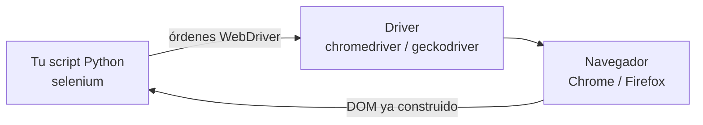
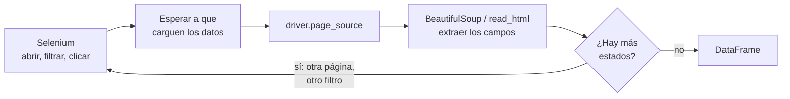

# Manual de Selenium para páginas web dinámicas

**Módulo:** MP5074 – Sistemas de Big Data · Curso 2026-27

> Muchas webs no envían los datos en el HTML: los cargan con **JavaScript** cuando la página ya está abierta en el navegador. `requests` y BeautifulSoup no ejecutan JavaScript, así que no los ven. **Selenium** controla un navegador real desde Python: abre la página, deja que el JavaScript trabaje, pulsa botones, rellena formularios, espera a que aparezcan los datos y te los entrega. Este manual explica cuándo hace falta, cómo usarlo de forma estable (con **esperas explícitas**) y cómo combinarlo con BeautifulSoup y pandas. Da por hecho que conoces `requests`, BeautifulSoup y los selectores CSS.

---

## Índice

1. [Páginas estáticas y dinámicas](#1-páginas-estáticas-y-dinámicas)
2. [Antes de Selenium: la pestaña Red](#2-antes-de-selenium-la-pestaña-red)
3. [Cómo funciona Selenium](#3-cómo-funciona-selenium)
4. [Instalación y primer navegador](#4-instalación-y-primer-navegador)
5. [Localizar elementos: `By`](#5-localizar-elementos-by)
6. [Interactuar con la página](#6-interactuar-con-la-página)
7. [Esperas: la clave de la estabilidad](#7-esperas-la-clave-de-la-estabilidad)
8. [Recorrer varias páginas](#8-recorrer-varias-páginas)
9. [Formularios](#9-formularios)
10. [Scroll infinito](#10-scroll-infinito)
11. [Selenium + BeautifulSoup](#11-selenium--beautifulsoup)
12. [De los datos a pandas](#12-de-los-datos-a-pandas)
13. [Buenas prácticas y scraping responsable](#13-buenas-prácticas-y-scraping-responsable)
14. [Solución de problemas frecuentes](#14-solución-de-problemas-frecuentes)
15. [Chuleta rápida](#15-chuleta-rápida)
16. [Referencias](#16-referencias)

---

## 1. Páginas estáticas y dinámicas

| | Página **estática** | Página **dinámica** |
|---|---|---|
| Qué envía el servidor | El HTML **con** los datos | Un HTML casi vacío **y** un programa en JavaScript |
| Dónde se construye la página | En el servidor | En el navegador, al ejecutar el JavaScript |
| ¿La ve `requests`? | ✅ Sí | ❌ No: descarga el HTML inicial, sin datos |
| Herramienta | `requests` + BeautifulSoup | Selenium (o la API que usa la página, [sección 2](#2-antes-de-selenium-la-pestaña-red)) |

Señales de que una página es dinámica:

- El dato aparece al **Inspeccionar** el elemento, pero no en **Ver código fuente** (`Ctrl+U`).
- Tu `select` de BeautifulSoup devuelve una **lista vacía** aunque el selector sea correcto.
- Los resultados aparecen **después** de pulsar un botón, elegir un filtro o bajar con la rueda del ratón (*scroll* infinito).

La web de prácticas **quotes.toscrape.com** tiene una versión dinámica en `/js/`. Lo comprobamos:

```python
import requests
from bs4 import BeautifulSoup

html = requests.get("https://quotes.toscrape.com/js/", timeout=10).text   # HTML tal como lo envía el servidor
sopa = BeautifulSoup(html, "html.parser")

len(sopa.select("div.quote"))     # 0  → en el HTML recibido no hay ninguna cita
"var data" in html                # True → los datos vienen dentro de un <script> que los pinta al ejecutarse
```

Cero citas, pero el texto `var data` aparece: los datos están en el código JavaScript, y solo se convierten en HTML cuando un navegador lo ejecuta.

---

## 2. Antes de Selenium: la pestaña Red

Selenium es lento (abre un navegador entero) y frágil (depende del aspecto de la página). **Úsalo como último recurso.** Antes, mira cómo consigue los datos la propia página:

1. Abre la página en Chrome o Firefox y pulsa `F12` (herramientas de desarrollador).
2. Ve a la pestaña **Red** (*Network*) y filtra por **Fetch/XHR**.
3. Recarga la página o haz la acción que carga los datos (clic, *scroll*…).
4. Si aparece una petición que devuelve **JSON** con los datos, ábrela: esa URL es la **API oculta** de la página.

Si esa URL funciona por sí sola, se llama con `requests` y se acabó el problema:

```python
import pandas as pd

# La versión /scroll de quotes.toscrape.com pide las citas a esta API, de 10 en 10
r = requests.get("https://quotes.toscrape.com/api/quotes", params={"page": 1}, timeout=10)
r.raise_for_status()                    # error si la respuesta no es 200 OK
datos = r.json()                        # el JSON se convierte en diccionario de Python
datos["has_next"]                       # True → hay más páginas
pd.json_normalize(datos["quotes"])      # text, tags, author.name, author.slug…
```

Selenium queda para cuando los datos dependen de **sesiones**, **formularios**, ***tokens*** o cálculos del JavaScript que no se pueden reproducir fácilmente con `requests`.

---

## 3. Cómo funciona Selenium

**Selenium** controla un **navegador real** desde un programa: abrir páginas, hacer clic, escribir, esperar y leer el resultado. Nació para hacer **pruebas automáticas** de aplicaciones web; en *scraping* se usa porque el navegador sí ejecuta el JavaScript.



| Pieza | Qué es |
|---|---|
| **WebDriver** | El estándar (del W3C) con el que un programa da órdenes a un navegador. En Python, también el objeto `driver`. |
| **Driver** | Programa intermedio propio de cada navegador (`chromedriver` para Chrome, `geckodriver` para Firefox) que traduce las órdenes. Su versión debe corresponder con la del navegador. |
| **Selenium Manager** | Desde Selenium 4.6, descarga **automáticamente** el driver correcto. Ya no hay que instalarlo a mano. |
| **DOM** | El árbol de elementos de la página **después** de ejecutar el JavaScript. Es lo que ves al Inspeccionar. |

---

## 4. Instalación y primer navegador

```bash
conda activate bigdata
conda install -c conda-forge selenium        # o: pip install selenium
```

Solo necesitas tener instalado **Google Chrome** (o Firefox). Selenium Manager se encarga del driver la primera vez que abres el navegador.

```python
from selenium import webdriver

opciones = webdriver.ChromeOptions()             # configuración del navegador
opciones.add_argument("--headless=new")          # sin ventana (quítalo para VER lo que hace)
opciones.add_argument("--window-size=1366,900")  # tamaño de la ventana virtual: algunas webs cambian según el tamaño

driver = webdriver.Chrome(options=opciones)      # abre Chrome (Firefox: webdriver.Firefox())
try:
    driver.get("https://quotes.toscrape.com/js/")   # navega a la página y espera a que cargue
    print(driver.title)                          # título de la pestaña
    print(driver.current_url)                    # URL actual (cambia si hay redirecciones)
    html = driver.page_source                    # HTML del DOM YA construido por el JavaScript
finally:
    driver.quit()                                # cierra el navegador SIEMPRE, aunque haya un error
```

- **Modo *headless*** (sin cabeza): el navegador funciona sin mostrar ventana. Es más rápido y es la única opción en servidores sin pantalla. Mientras desarrollas, quítalo para **ver** lo que hace.
- **`driver.quit()`** es imprescindible: cada navegador abierto ocupa cientos de MB. `try/finally` garantiza que se cierra aunque el código falle a mitad.
- `driver.close()` cierra solo la pestaña actual; `driver.quit()` cierra el navegador y el driver.

Ahora sí aparecen las citas:

```python
driver = webdriver.Chrome(options=opciones)
try:
    driver.get("https://quotes.toscrape.com/js/")
    sopa = BeautifulSoup(driver.page_source, "html.parser")   # el mismo análisis de antes, sobre el DOM renderizado
    print(len(sopa.select("div.quote")))                      # 10 → el navegador ha ejecutado el JavaScript
finally:
    driver.quit()
```

---

## 5. Localizar elementos: `By`

```python
from selenium.webdriver.common.by import By

driver = webdriver.Chrome(options=opciones)
driver.get("https://quotes.toscrape.com/js/")

primera = driver.find_element(By.CSS_SELECTOR, "div.quote")    # el PRIMERO que encaja; error si no hay ninguno
todas = driver.find_elements(By.CSS_SELECTOR, "div.quote")     # LISTA con todos; lista vacía si no hay
len(todas)                                                     # 10
```

| Estrategia | Ejemplo | Busca por |
|---|---|---|
| `By.CSS_SELECTOR` | `"div.quote span.text"` | Selector CSS. **La más versátil**: los mismos selectores que en BeautifulSoup |
| `By.ID` | `"username"` | Atributo `id` |
| `By.NAME` | `"password"` | Atributo `name` (campos de formulario) |
| `By.CLASS_NAME` | `"quote"` | Una sola clase |
| `By.TAG_NAME` | `"table"` | Nombre de la etiqueta |
| `By.LINK_TEXT` | `"Logout"` | Texto exacto de un enlace |
| `By.PARTIAL_LINK_TEXT` | `"Next"` | Parte del texto de un enlace |
| `By.XPATH` | `"//a[contains(text(), 'Next')]"` | XPath: permite buscar por texto o subir al elemento padre |

Lo que se puede hacer con un elemento (`WebElement`):

```python
cita = todas[0]
cita.text                                                    # texto VISIBLE del elemento y sus hijos
cita.find_element(By.CSS_SELECTOR, "span.text").text         # buscar DENTRO del elemento
cita.find_element(By.CSS_SELECTOR, "small.author").text      # el autor de esa cita
[t.text for t in cita.find_elements(By.CSS_SELECTOR, "a.tag")]   # lista con sus etiquetas
cita.find_element(By.CSS_SELECTOR, "a.tag").get_attribute("href")  # valor de un atributo
cita.is_displayed()                                          # ¿está visible?
driver.quit()
```

> `.text` solo devuelve el texto **visible**. Para el texto de un elemento oculto usa `.get_attribute("textContent")`.

---

## 6. Interactuar con la página

| Acción | Código |
|---|---|
| Hacer clic | `elemento.click()` |
| Escribir en un campo | `campo.send_keys("texto")` |
| Borrar un campo | `campo.clear()` |
| Pulsar una tecla | `campo.send_keys(Keys.ENTER)` |
| Elegir en un desplegable | `Select(elemento).select_by_visible_text("2025")` |
| Desplazarse hasta abajo | `driver.execute_script("window.scrollTo(0, document.body.scrollHeight);")` |
| Volver atrás / recargar | `driver.back()` / `driver.refresh()` |
| Captura de pantalla | `driver.save_screenshot("pagina.png")` |

Importaciones necesarias:

```python
from selenium.webdriver.common.keys import Keys      # teclas especiales: ENTER, TAB, ESCAPE, PAGE_DOWN…
from selenium.webdriver.support.ui import Select     # para manejar <select> (desplegables)
```

Ejemplo con un desplegable (en una página que tuviera `<select id="anio">`):

```py
desplegable = Select(driver.find_element(By.ID, "anio"))   # envolvemos el <select> en un objeto Select
[o.text for o in desplegable.options]                      # todas las opciones disponibles
desplegable.select_by_visible_text("2025")                 # elige por el texto que ve el usuario
desplegable.select_by_value("2025")                        # o por el atributo value de la opción
```

`execute_script` ejecuta JavaScript dentro de la página y puede **devolver** un valor a Python:

```python
driver = webdriver.Chrome(options=opciones)
driver.get("https://quotes.toscrape.com/js/")
driver.execute_script("return document.querySelectorAll('div.quote').length")   # 10
driver.execute_script("return document.body.scrollHeight")                      # altura de la página en píxeles
driver.quit()
```

---

## 7. Esperas: la clave de la estabilidad

Tras un `get` o un clic, el JavaScript tarda un tiempo **variable** en cargar los datos. Si buscas un elemento demasiado pronto, obtienes `NoSuchElementException`. Hay tres formas de esperar:

| Tipo | Cómo | Problema |
|---|---|---|
| Pausa fija | `time.sleep(5)` | Si carga en 1 s, pierdes 4; si tarda 6, falla igual |
| Espera implícita | `driver.implicitly_wait(10)`: cada `find_element` reintenta hasta 10 s | Global y poco controlable; no sabe esperar a «que sea clicable» |
| **Espera explícita** | `WebDriverWait`: esperar a una **condición concreta** con un tiempo máximo | Ninguno: es la recomendada ✅ |

```python
from selenium.webdriver.support.ui import WebDriverWait
from selenium.webdriver.support import expected_conditions as EC

driver = webdriver.Chrome(options=opciones)
espera = WebDriverWait(driver, timeout=10)      # esperará como máximo 10 s en cada until

driver.get("https://quotes.toscrape.com/js-delayed/")      # versión en la que las citas tardan unos segundos
# until comprueba la condición cada 0,5 s y continúa EN CUANTO se cumple
citas = espera.until(EC.presence_of_all_elements_located((By.CSS_SELECTOR, "div.quote")))
len(citas)
driver.quit()
```

Fíjate en los **dobles paréntesis**: el localizador se pasa como **una tupla** `(By.CSS_SELECTOR, "div.quote")`. Si pasa el tiempo máximo sin cumplirse, `until` lanza `TimeoutException`.

| Condición (`EC.`) | Se cumple cuando… |
|---|---|
| `presence_of_element_located(loc)` | El elemento existe en el DOM (aunque no se vea) |
| `presence_of_all_elements_located(loc)` | Hay al menos uno; devuelve la lista |
| `visibility_of_element_located(loc)` | Existe **y** se ve |
| `element_to_be_clickable(loc)` | Se ve y está habilitado: se puede pulsar |
| `text_to_be_present_in_element(loc, "texto")` | El elemento contiene ese texto |
| `staleness_of(elemento)` | Ese elemento **ya no está** en el DOM (la página ha cambiado) |
| `url_contains("texto")` | La URL actual contiene ese texto |

> **Regla:** después de cada acción que cambia la página (`get`, `click`, `send_keys` + ENTER, *scroll*), una espera explícita a algo que confirme el cambio.

---

## 8. Recorrer varias páginas

Patrón para extraer todas las páginas pulsando el botón **Next**:

```python
from selenium.common.exceptions import TimeoutException

def extraer_citas_pagina(driver):
    """Lee las citas de la página actual con Selenium. Devuelve una lista de diccionarios."""
    filas = []
    for b in driver.find_elements(By.CSS_SELECTOR, "div.quote"):
        filas.append({
            "texto": b.find_element(By.CSS_SELECTOR, "span.text").text,
            "autor": b.find_element(By.CSS_SELECTOR, "small.author").text,
            "etiquetas": [t.text for t in b.find_elements(By.CSS_SELECTOR, "a.tag")],
        })
    return filas

driver = webdriver.Chrome(options=opciones)
espera = WebDriverWait(driver, 10)
citas = []
try:
    driver.get("https://quotes.toscrape.com/js/")
    while True:
        bloques = espera.until(EC.presence_of_all_elements_located((By.CSS_SELECTOR, "div.quote")))
        citas.extend(extraer_citas_pagina(driver))                  # añade las 10 citas de esta página

        siguiente = driver.find_elements(By.CSS_SELECTOR, "li.next a")   # lista vacía en la última página
        if not siguiente:
            break                                                   # no hay botón «Next»: hemos terminado
        siguiente[0].click()                                        # pasamos de página…
        espera.until(EC.staleness_of(bloques[0]))                   # …y esperamos a que la anterior desaparezca
finally:
    driver.quit()

len(citas)        # 100
```

Detalles importantes:

- **`staleness_of`**: tras el clic esperamos a que el primer bloque de la página anterior quede **obsoleto** (ya no está en el DOM). Si no, podríamos leer otra vez la misma página antes de que cargue la nueva.
- Comprobamos si hay botón con **`find_elements`** (lista vacía = no hay) en lugar de esperar con `until`, que tardaría 10 s en rendirse en la última página.
- Si la paginación cambia la URL (`/js/page/2/`), a veces es más sencillo y robusto ir directamente con `driver.get(url_de_cada_pagina)`.

---

## 9. Formularios

`quotes.toscrape.com/login` acepta **cualquier** usuario y contraseña. Patrón: localizar los campos, escribir, pulsar y **esperar a una señal** de que ha funcionado.

```python
driver = webdriver.Chrome(options=opciones)
espera = WebDriverWait(driver, 10)
try:
    driver.get("https://quotes.toscrape.com/login")
    usuario = espera.until(EC.visibility_of_element_located((By.ID, "username")))   # esperar al formulario
    usuario.send_keys("alumna")                                                     # escribir el usuario
    driver.find_element(By.ID, "password").send_keys("1234")                        # escribir la contraseña
    driver.find_element(By.CSS_SELECTOR, "input[type='submit']").click()            # pulsar «Login»

    espera.until(EC.presence_of_element_located((By.LINK_TEXT, "Logout")))          # señal: ya hay enlace Logout
    print("Sesión iniciada en:", driver.current_url)
finally:
    driver.quit()
```

> Nunca escribas contraseñas reales en un notebook que vayas a subir a GitHub. Si hacen falta, léelas de una variable de entorno (`os.environ["CLAVE"]`) o de un fichero que esté en `.gitignore`.

---

## 10. Scroll infinito

Algunas páginas no tienen botón «Next»: cargan más elementos cuando **bajas hasta el final**. El patrón es bajar, esperar a que aumente el número de elementos y repetir hasta que deje de aumentar.

```python
driver = webdriver.Chrome(options=opciones)
espera = WebDriverWait(driver, 10)
try:
    driver.get("https://quotes.toscrape.com/scroll")
    espera.until(EC.presence_of_element_located((By.CSS_SELECTOR, "div.quote")))   # primeras citas cargadas

    while True:
        antes = len(driver.find_elements(By.CSS_SELECTOR, "div.quote"))            # cuántas hay ahora
        driver.execute_script("window.scrollTo(0, document.body.scrollHeight);")  # bajar hasta el final
        try:
            # esperar hasta que haya MÁS citas que antes (la condición es una función que devuelve True/False)
            espera.until(lambda d: len(d.find_elements(By.CSS_SELECTOR, "div.quote")) > antes)
        except TimeoutException:
            break                                   # en 10 s no ha cargado nada nuevo: no hay más
    total = len(driver.find_elements(By.CSS_SELECTOR, "div.quote"))
finally:
    driver.quit()

total             # 100
```

`until` admite cualquier **función** que reciba el `driver` y devuelva algo verdadero cuando se cumple la condición: así puedes esperar a cosas que no están en la lista de `EC`.

> Recuerda la [sección 2](#2-antes-de-selenium-la-pestaña-red): esta misma página pide los datos a `/api/quotes?page=N`. Con `requests` se obtienen las 100 citas sin navegador.

---

## 11. Selenium + BeautifulSoup

Selenium **descarga la página entera** y la tiene en tu equipo: el navegador la carga, ejecuta el JavaScript y construye el DOM en local. La diferencia está en **dónde** está ese DOM:

- El DOM vive **dentro del navegador**, que es un programa distinto de tu script de Python.
- Cada `find_element`, cada `.text` y cada `.get_attribute` es una **orden** que Python envía al driver, el driver al navegador, y la respuesta vuelve por el mismo camino. No se conecta con el servidor web, pero cada orden es una comunicación entre programas.
- Leer 100 citas con 3 campos cada una son **cientos de órdenes**. `driver.page_source` es **una sola orden**: trae todo el HTML a la memoria de Python, y a partir de ahí BeautifulSoup trabaja sin salir de tu programa, casi al instante.

| | Solo Selenium (`find_element` + `.text`) | Selenium + BeautifulSoup (`page_source`) |
|---|---|---|
| Órdenes al navegador por página | Una por cada campo de cada elemento | **Una** |
| Velocidad con muchos datos | Lenta | Rápida |
| Errores `StaleElementReference` | Posibles si la página cambia mientras lees | No: trabajas sobre una copia fija |
| Probar sin navegador | No | Sí: guardas el HTML y pruebas `extraer` sobre el fichero |

Con pocos datos (unos pocos campos) leer con Selenium es perfectamente válido. Con muchos, conviene repartir el trabajo:



- **Selenium**: solo para llevar la página al **estado** que contiene los datos.
- **`driver.page_source`**: una «foto» del DOM en ese instante.
- **BeautifulSoup** (o `pd.read_html` si es una tabla): para extraer.

### 11.1 El momento de la foto

`page_source` devuelve el DOM **en el instante** en que se llama. Si lo llamas antes de que el JavaScript termine, la foto sale sin datos o con los de la página anterior. Por eso va **siempre después de una espera explícita**:

```py
espera.until(EC.presence_of_element_located((By.CSS_SELECTOR, "div.quote")))   # 1.º confirmar que están los datos
sopa = BeautifulSoup(driver.page_source, "html.parser")                       # 2.º hacer la foto
```

### 11.2 Tablas: `read_html` sobre `page_source`

Si los datos están en una `<table>`, es aún más directo: Selenium pone el HTML y **pandas** lo convierte en DataFrame, sin recorrer `<tr>` y `<td>` a mano.

```py
from io import StringIO
import pandas as pd

html = driver.page_source                          # Selenium: HTML ya renderizado (str)
tablas = pd.read_html(StringIO(html),              # pandas: cada <table> → un DataFrame
                      attrs={"id": "resultados"})  # solo las <table id="resultados">
tabla = tablas[0]                                  # read_html SIEMPRE devuelve una lista
```

Pieza a pieza:

| Parte | De quién es | Qué hace |
|---|---|---|
| `driver.page_source` | Selenium | Devuelve el HTML del DOM en ese instante, con el JavaScript ya ejecutado, como texto (`str`). |
| `StringIO(html)` | Python (`io`) | Envuelve el texto para que se lea como si fuera un fichero. |
| `pd.read_html(...)` | pandas | Busca todas las `<table>` del HTML y devuelve una **lista de DataFrames**, una por tabla. |
| `attrs={"id": "resultados"}` | pandas | Filtra por atributos HTML: solo se queda con las tablas que tengan ese `id`. |
| `[0]` | Python | Coge el primer DataFrame de la lista. Aunque solo haya una tabla que encaje, devuelve una lista. |

!!! info "¿Por qué `StringIO`?"
    Desde pandas 2.1, pasar el HTML como texto directamente a `read_html` está obsoleto y da un `FutureWarning`, porque pandas no sabe si esa cadena es HTML, una ruta o una URL. Con `StringIO` queda claro que es contenido.

!!! warning "Requisitos y errores típicos"
    `read_html` necesita un *parser* instalado: `lxml` (recomendado) o bien `beautifulsoup4` + `html5lib`. Si no hay ninguno, da `ImportError`. Si no encuentra ninguna tabla que encaje, da `ValueError: No tables found`.

`read_html` pierde los enlaces y los atributos (iconos, clases). Si los necesitas, usa BeautifulSoup.

### 11.3 Estructura recomendada del código

Separar **navegar** de **extraer** hace el código más claro y permite probar la extracción con un HTML guardado, sin abrir el navegador:

```python
def abrir_navegador(headless=True):
    """Crea el navegador y su espera explícita."""
    opciones = webdriver.ChromeOptions()
    if headless:
        opciones.add_argument("--headless=new")
    driver = webdriver.Chrome(options=opciones)
    return driver, WebDriverWait(driver, 10)

def extraer(html):
    """BeautifulSoup: de un HTML a una lista de diccionarios (no usa Selenium)."""
    sopa = BeautifulSoup(html, "html.parser")
    return [
        {
            "texto": q.select_one("span.text").get_text(strip=True),
            "autor": q.select_one("small.author").get_text(strip=True),
            "etiquetas": [t.get_text(strip=True) for t in q.select("a.tag")],
        }
        for q in sopa.select("div.quote")
    ]

driver, espera = abrir_navegador()
citas = []
try:
    for n in range(1, 11):                                            # las 10 páginas, yendo directamente a su URL
        driver.get(f"https://quotes.toscrape.com/js/page/{n}/")
        espera.until(EC.presence_of_element_located((By.CSS_SELECTOR, "div.quote")))   # esperar a los datos
        citas.extend(extraer(driver.page_source))                     # foto + extracción con BeautifulSoup
finally:
    driver.quit()

len(citas)        # 100
```

> Puedes guardar el HTML de una página (`Path("pagina1.html").write_text(driver.page_source, encoding="utf-8")`) y desarrollar `extraer` sobre ese fichero sin volver a abrir el navegador.

---

## 12. De los datos a pandas

La lista de diccionarios se convierte directamente en un `DataFrame` (ver el [manual de pandas](../pandas/manual_pandas.md)):

```python
import pandas as pd

citas_df = pd.DataFrame(citas)                    # una fila por cita: texto, autor, etiquetas (lista)
citas_df["autor"].value_counts().head()           # autores con más citas

etiquetas = citas_df.explode("etiquetas")         # una fila por cita y etiqueta
etiquetas["etiquetas"].value_counts().head(10)    # las 10 etiquetas más usadas

citas_df.to_parquet("citas.parquet", index=False)   # guardar en Parquet (las listas se conservan)
```

Comprobaciones antes de dar el resultado por bueno:

```python
len(citas_df)                                     # ¿el número esperado de filas?
citas_df.duplicated(subset=["texto"]).sum()       # 0 → no hemos leído dos veces la misma página
citas_df.isna().sum()                             # ¿algún campo vacío?
```

---

## 13. Buenas prácticas y scraping responsable

1. **Mira primero la pestaña Red**: si hay una API, usa `requests` ([sección 2](#2-antes-de-selenium-la-pestaña-red)).
2. **Esperas explícitas**, nunca `time.sleep` como forma de esperar a que cargue algo.
3. **`try/finally` + `driver.quit()`** siempre.
4. **Selenium para navegar, BeautifulSoup para extraer.**
5. **Desarrolla con ventana** y pasa a *headless* cuando funcione.
6. **Selectores robustos**: prefiere `id`, `name` y clases con significado (`div.quote`) a rutas largas (`div > div:nth-child(3) > span`), que se rompen al mínimo cambio de diseño.
7. **Comprueba el resultado** con conocimiento del dominio: número de filas, duplicados, valores imposibles.
8. **Respeta la web**: revisa `robots.txt` y las condiciones de uso, deja pausas entre páginas (`time.sleep(1)` *entre* páginas sí es buena educación), no descargues más de lo necesario y no recojas datos personales sin una base legal (RGPD).

---

## 14. Solución de problemas frecuentes

| Problema | Causa probable | Solución |
|---|---|---|
| `SessionNotCreatedException: This version of ChromeDriver only supports Chrome version …` | Driver y navegador de versiones distintas | Actualiza Selenium (`pip install -U selenium`) para que Selenium Manager descargue el driver correcto; actualiza Chrome |
| `NoSuchElementException` | Selector incorrecto, o el elemento aún no ha cargado | Comprueba el selector en *Inspeccionar*; usa una espera explícita |
| `TimeoutException` | La condición no se cumplió en el tiempo máximo | Selector o condición incorrectos; aumenta el `timeout`; haz una captura (`save_screenshot`) para ver qué hay |
| `StaleElementReferenceException` | Usas un elemento de antes de que la página cambiara | Vuelve a buscarlo después del cambio |
| `ElementClickInterceptedException` | Otro elemento (anuncio, aviso de cookies) tapa el botón | Cierra el aviso; espera con `element_to_be_clickable`; desplázate hasta el elemento |
| Lees dos veces la misma página | No esperaste a que cambiara tras el clic | `espera.until(EC.staleness_of(elemento_viejo))` |
| La lista sale vacía en *headless* pero no con ventana | La web muestra otra versión según el tamaño o detecta el modo *headless* | `--window-size=1366,900`; prueba con ventana |
| El script se queda colgado y quedan Chromes abiertos | Faltó `driver.quit()` | `try/finally`; cierra los procesos desde el administrador de tareas |

---

## 15. Chuleta rápida

```py
from selenium import webdriver
from selenium.webdriver.common.by import By
from selenium.webdriver.common.keys import Keys
from selenium.webdriver.support.ui import WebDriverWait, Select
from selenium.webdriver.support import expected_conditions as EC
from selenium.common.exceptions import TimeoutException

# ---------- Abrir y cerrar ----------
op = webdriver.ChromeOptions(); op.add_argument("--headless=new")
driver = webdriver.Chrome(options=op); espera = WebDriverWait(driver, 10)
try: ...
finally: driver.quit()

# ---------- Navegar ----------
driver.get(url); driver.back(); driver.refresh(); driver.title; driver.current_url; driver.page_source

# ---------- Localizar ----------
driver.find_element(By.CSS_SELECTOR, "sel");  driver.find_elements(By.CSS_SELECTOR, "sel")
el.text;  el.get_attribute("href");  el.find_element(By.CSS_SELECTOR, "sel")

# ---------- Interactuar ----------
el.click();  el.clear();  el.send_keys("texto", Keys.ENTER);  Select(el).select_by_visible_text("x")
driver.execute_script("window.scrollTo(0, document.body.scrollHeight);")

# ---------- Esperar ----------
espera.until(EC.presence_of_element_located((By.CSS_SELECTOR, "sel")))
espera.until(EC.element_to_be_clickable((By.ID, "boton"))).click()
espera.until(EC.staleness_of(el_viejo));  espera.until(lambda d: condicion(d))

# ---------- Extraer ----------
sopa = BeautifulSoup(driver.page_source, "html.parser")
pd.read_html(StringIO(driver.page_source))
```

---

## 16. Referencias

- Documentación oficial de Selenium: [selenium.dev/documentation](https://www.selenium.dev/documentation/)
- Esperas en Selenium: [Waiting strategies](https://www.selenium.dev/documentation/webdriver/waits/)
- Selenium Manager: [selenium.dev/documentation/selenium_manager](https://www.selenium.dev/documentation/selenium_manager/)
- Webs para practicar: [quotes.toscrape.com](https://quotes.toscrape.com/) (versiones `/js/`, `/js-delayed/`, `/scroll`, `/login`)
- Documentación de BeautifulSoup: [crummy.com/software/BeautifulSoup/bs4/doc](https://www.crummy.com/software/BeautifulSoup/bs4/doc/)
